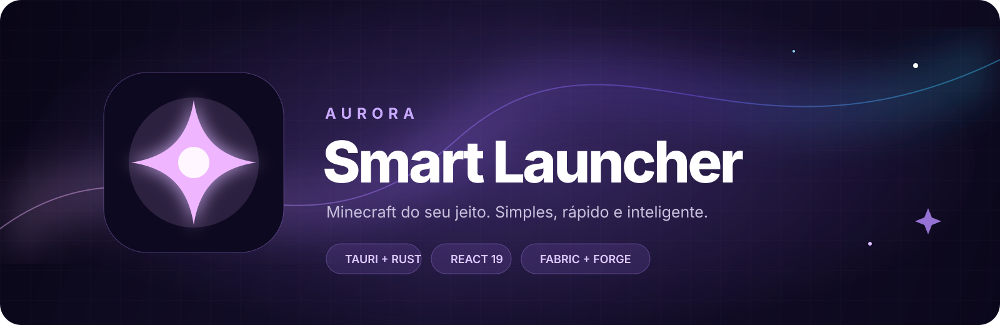

<p align="center"></p>

# Aurora Smart Launcher

Launcher independente para Minecraft Java Edition no Windows x64. Organize modpacks em instâncias separadas, escolha skins e compartilhe mundos abertos para LAN.

**[Baixar o instalador da beta para Windows](https://github.com/vinitor3/AuroraLauncher/releases/download/v0.2.0-beta.2/Aurora-Smart-Launcher_0.2.0-beta.2_x64-setup.exe)** · [Notas, manifesto e SHA-256](https://github.com/vinitor3/AuroraLauncher/releases/tag/v0.2.0-beta.2)

A beta é experimental. A conta Aurora identifica seu perfil e suas amizades. A autenticação Microsoft e a verificação de posse do Minecraft estão previstas para o final do projeto. O instalador distribui o launcher e os módulos Aurora. Minecraft é adquirido separadamente.

## Primeiros passos

1. Execute o instalador e entre na sua conta Aurora.
2. Crie uma instância na biblioteca ou escolha um modpack em **Descobrir**.
3. Abra **Editar** para ajustar o conteúdo ou a memória da instância. O padrão para todas fica em **Java & engine**.

Consulte o [guia rápido](docs/README.md) para skins, temas, mods, amigos e diagnóstico. A [página da beta](docs/beta.md) resume o que mudou e os limites dos testes.

## Desenvolvimento

No Windows, instale Node.js 24, Rust estável com MSVC, Windows SDK, WebView2 e os JDKs exigidos pela matriz. Abra um terminal na raiz do repositório.

```powershell
npm ci --prefix apps/desktop
npm run desktop:dev
```

[Compilar o instalador](docs/release-workflow.md) · [Matriz dos módulos](scripts/active-mod-matrix.json) · [Contribuir](CONTRIBUTING.md) · [Segurança](SECURITY.md) · [Licenças](THIRD_PARTY_NOTICES.md)

Projeto independente, sem afiliação com Mojang ou Microsoft.
