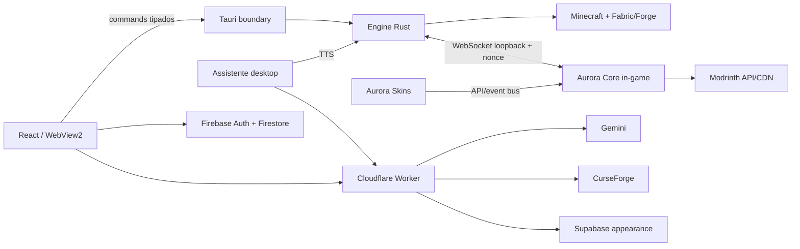
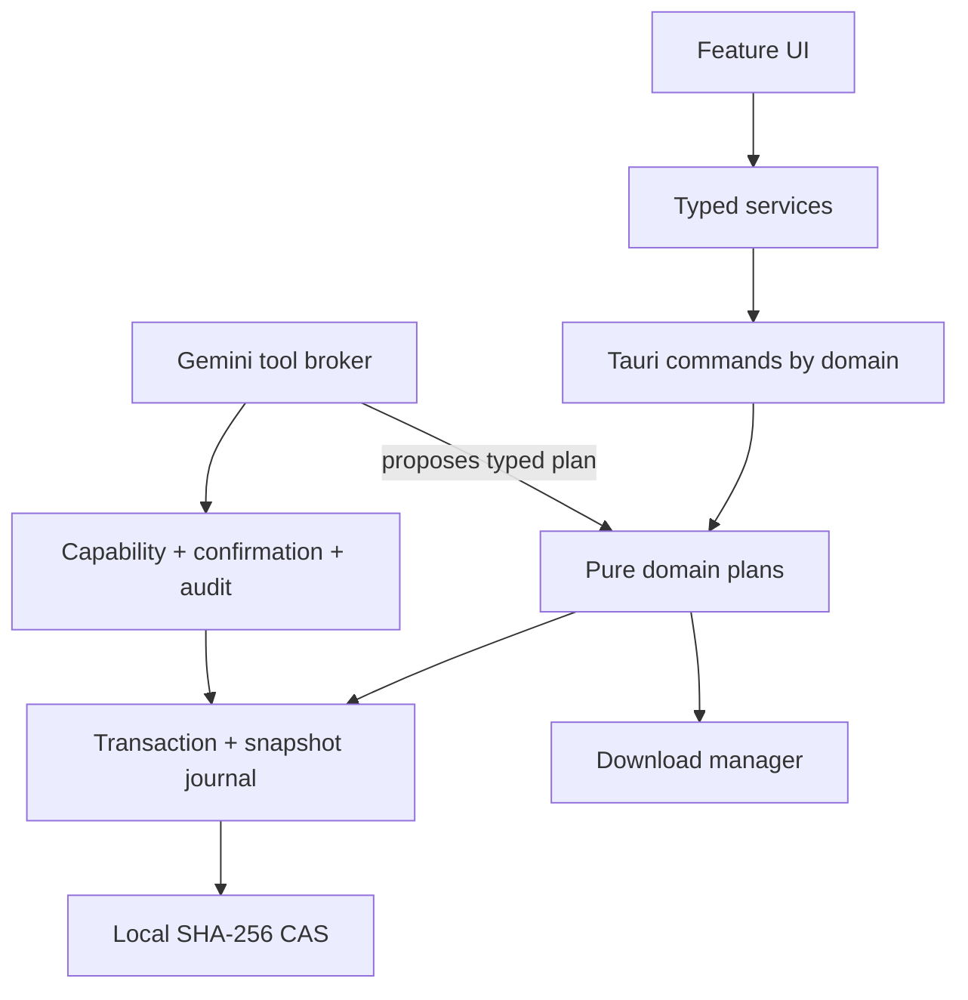

# Architecture Review

## Arquitetura atual confirmada

Secrets permanecem fora do cliente, o jogo não recebe JWT e a engine local controla caminhos/processos. O Core é o único dono do WebSocket do jogo. O Assistente permanece no Aurora Launcher; o mod Companion e sua integração in-game foram retirados. O painel chama o Worker autenticado e reproduz a resposta pelo TTS desktop sem depender do IPC ou de Minecraft.

## Fronteiras a corrigir

| Fronteira | Estado | Evolução |
| --- | --- | --- |
| `App.tsx` (2.293 linhas) | alto acoplamento | extrair features/serviços por comportamento; lazy-load de Discover/Wardrobe/Assistant |
| `commands.rs` (1.582 linhas) | domínio misturado | preservar nomes Tauri e mover implementação para módulos `commands/*` |
| Worker `index.ts` (456 linhas) | rotas e infraestrutura juntas | router fino + `auth`, `rate_limit`, `assistant`, `curseforge`, `appearance` |
| metadados de conteúdo | provider-specific | inventário normalizado e plano de atualização puro antes de IO |
| mutações locais | sem transação geral | journal/snapshot mínimo; depois CAS SHA-256 + SQLite |

## Arquitetura alvo incremental

### Assistente desktop e IPC do Core

O fluxo mantido é `AssistantPanel → askAuroraAssistant → /v1/assistant → askGemini → painel / playAuroraSpeech → synthesize_speech`. Microfone, reconhecimento de fala, mute, transporte autenticado e `edge-tts-rust` permanecem.

O fluxo `Companion → IPC → Gemini/voz → jogo` foi retirado. Não há registro `aurora_companion`, página `aurora_assistant`, comandos de retorno de voz/captura nem telemetria exclusiva desse produtor. O IPC preserva protocolo, handshake, sessão pública, limites e eventos genéricos para Core/Skins. As decisões e a migração estão na [ADR-018](ADR/ADR-018-remove-companion-keep-desktop-assistant.md).

### Updater e CAS

1. Inventário imutável: provider, projectId, fileId, version, gameVersion, loader, hashes e dependências.
2. Resolver produz `UpdatePlan` sem tocar no disco: `SAFE`, `AMBIGUOUS`, `BLOCKED`.
3. Executor cria snapshot/journal, baixa para staging, valida e troca por rename.
4. Rollback reaplica manifesto anterior.
5. CAS futuro: `blobs/sha256/aa/<digest>`, manifesto versionado e índice SQLite transacional. GC apenas remove blobs não alcançáveis por instância/snapshot retido.

### Gemini Tools

O modelo propõe chamadas; nunca executa. O broker valida schema, capability, raiz de caminho, precondição e orçamento. Níveis 0/1 podem começar após parser/Doctor somente leitura. Nível 2 exige diff + snapshot + confirmação. Nível 3 fica adiado.

### Master e multiplayer

Master só começa depois de manifesto v3, roles e auditoria. Multiplayer separa descoberta/convite, autenticação de sessão e transporte. O IPC local nunca vira canal remoto. A revisão [Aurora Connect V2](AURORA_CONNECT_SPEC.md) propõe registro de serviços autorizados, ponte de bytes TCP e ponte UDP bidirecional com retorno por participante/associação; inclui transporte de Simple Voice Chat e Plasmo Voice, sem criar voz própria. Avaliar Iroh primeiro, comparar Quinn e medir e4mc/World Host conforme escopo real; nenhum transporte foi implementado por essa revisão. Direto preferido, relay gratuito condicionado a termos/uso/quotas verificados, sem gasto obrigatório/automático e sem infraestrutura própria obrigatória. Gates anteriores e retirada Companion/HUD permanecem.

## Princípios

- Planos puros antes de efeitos colaterais.
- Identidade/autorização verificadas em toda fronteira, não confiadas ao modelo/UI.
- Toda escrita relevante tem staging, validação, commit e rollback.
- Compatibilidade é dado observado, não promessa de build.
- Custo zero significa limite rígido + modo degradado, nunca serviço ilimitado implícito.
