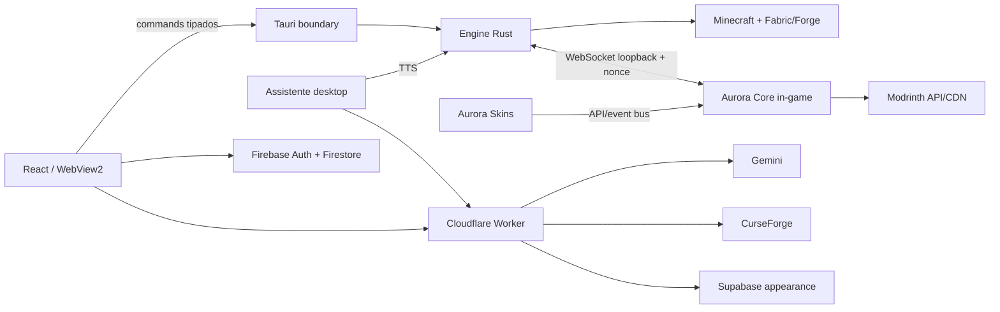
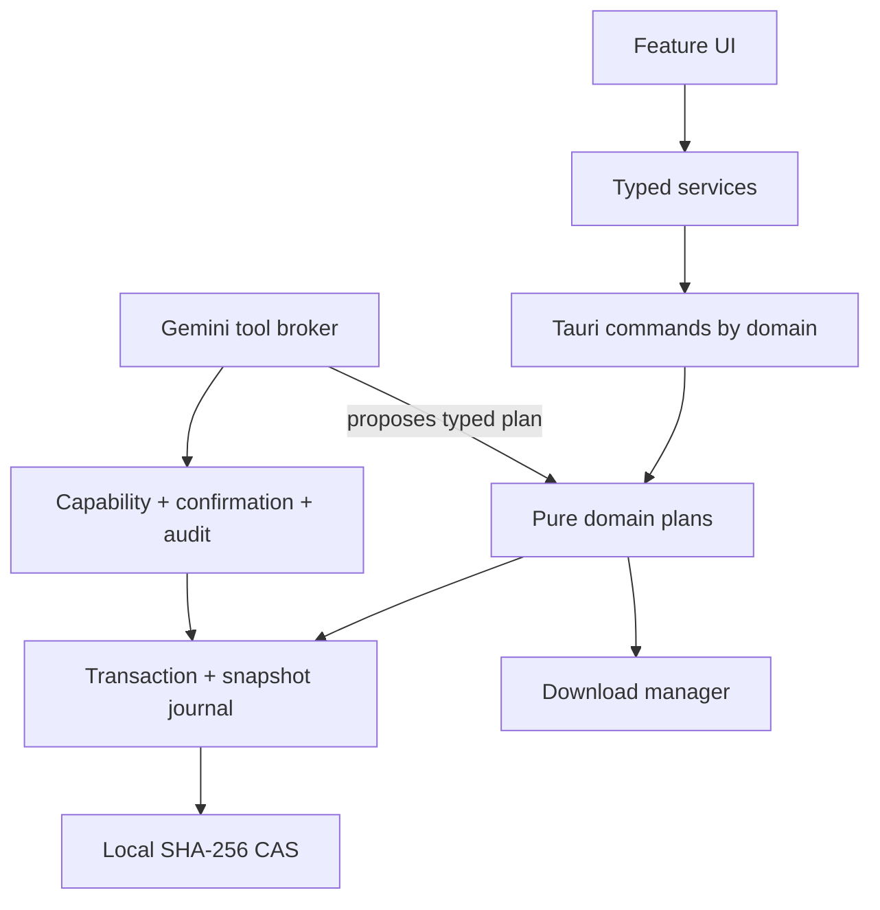

# Architecture Review

## Arquitetura atual confirmada

Referência desta atualização: alpha.14, `6a107b8`, em 29/09/2026.
Contratos e resultados das entregas são citados abaixo; a revisão documental
não equivale a uma nova auditoria completa do código nem a homologação runtime.

Secrets permanecem fora do cliente, o jogo não recebe JWT e a engine local controla caminhos/processos. O Core é o único dono do WebSocket do jogo. O Assistente permanece no Aurora Launcher; o mod Companion e sua integração in-game foram retirados. O painel chama o Worker autenticado e reproduz a resposta pelo TTS desktop sem depender do IPC ou de Minecraft.

## Fronteiras a corrigir

| Fronteira | Estado | Evolução |
| --- | --- | --- |
| `App.tsx` | integração central, com features extraídas nas entregas posteriores | continuar extração por comportamento, preservando telas e ownership exclusivo; contagens antigas de linhas não são baseline atual |
| `commands.rs` | fronteira central de comandos, com domínios nativos existentes | preservar nomes Tauri; modularização adicional exige inventário atual e não pode duplicar recovery/Doctor/Tools |
| Worker `index.ts` | integração de rotas e infraestrutura | preservar transporte Gemini compartilhado e limites; decidir decomposição a partir do código atual |
| metadados de conteúdo | inventário/resolução normalizados já entregues no updater | preservar plano antes de IO e homologar casos reais por provedor; novos serviços Connect têm contrato próprio |
| mutações locais | contratos específicos de updater, Tools e recuperação | preservar locks/journals; CAS SHA-256 + SQLite já existe na recuperação, sem migração geral dos executores |

## Arquitetura alvo incremental

### Assistente desktop e IPC do Core

O fluxo mantido é `AssistantPanel → askAuroraAssistant → /v1/assistant → askGemini → painel / playAuroraSpeech → synthesize_speech`. Microfone, reconhecimento de fala, mute, transporte autenticado e `edge-tts-rust` permanecem.

O fluxo `Companion → IPC → Gemini/voz → jogo` foi retirado. Não há registro `aurora_companion`, página `aurora_assistant`, comandos de retorno de voz/captura nem telemetria exclusiva desse produtor. O IPC preserva protocolo, handshake, sessão pública, limites e eventos genéricos para Core/Skins. As decisões e a migração estão na [ADR-018](ADR/ADR-018-remove-companion-keep-desktop-assistant.md).

### Updater e CAS

1. Inventário imutável: provider, projectId, fileId, version, gameVersion, loader, hashes e dependências.
2. Resolver produz `UpdatePlan` sem tocar no disco: `SAFE`, `AMBIGUOUS`, `BLOCKED`.
3. Executor cria snapshot/journal, baixa para staging, valida e troca por rename.
4. Rollback reaplica manifesto anterior.
5. CAS local já implementado **somente na Recuperação**: blobs SHA-256 independentes, manifesto versionado e índice SQLite transacional. Exclusão conserva blobs sem referências; GC e adoção geral pelo downloader/updater continuam pendentes.

Os pontos manuais incluem mods/configurações elegíveis e o nome permitido do perfil, excluem mundos e módulos administrados e exigem identidade verificada, prévia, confirmação e revalidação. Uma edição concorrente impede restauração cega. [Contrato de recuperação](../instance-recovery.md), [ADR-027](ADR/ADR-027-manual-instance-recovery.md).

### Doctor e cópias de diagnóstico

Doctor determinístico preserva a instância e usa fatos locais com limites explícitos; Gemini opcional explica contexto sanitizado. Na alpha.14, observações por tentativa e identidade relacionam mudanças e pontos sem provar causalidade. Cópias de teste têm arquivos e identidades independentes; aplicação seletiva à origem usa o executor da recuperação, proteção, confirmação e desfazer. Mundo pode ser copiado por seleção explícita, mas nunca aplicado/restaurado à origem por esse fluxo. Estado: **IMPLEMENTADO MAS NÃO HOMOLOGADO**. [Doctor](../aurora-doctor.md), [cópias](../diagnostic-lab.md), [ADR-028](ADR/ADR-028-doctor-recovery-lab.md), [resultados alpha.14](../task-aur-1167-doctor-lab.md).

### Gemini Tools

O modelo propõe; o broker Rust já implementado valida o alvo do inventário, schema, limites, identidade, estado e autorização. `remove_mod` e `set_setting` cobrem somente mods identificados e opções JSON permitidas, com plano/diff, confirmação separada, lock, backup, journal autenticado e restauração confirmada. Esses backups não foram migrados ao CAS. Estado: **IMPLEMENTADO MAS NÃO HOMOLOGADO**; a extensão de nível 2 continua sujeita aos controles do próprio domínio, e nível 3 permanece adiado. Não há shell genérico ou execução automática de instruções do modelo. [Tools](../aurora-ai-tools.md), [ADR-025](ADR/ADR-025-confirmed-local-ai-tools.md).

### Master e multiplayer

Master continua dependente de manifesto v3, roles e auditoria. Aurora Connect é uma proposta R4 que separa identidade/autorização, sinalização, descoberta/NAT traversal, transporte, registro de serviços, adaptadores e interface. O IPC local nunca vira canal remoto nem reintroduz Companion/HUD.

A ponte TCP leva bytes de cada conexão por stream confiável autenticado, com backpressure e fechamento. A ponte UDP preserva datagramas e retorno por associação participante/sessão/serviço, com MTU, limites e filas próprios. Voz integra Simple Voice Chat e Plasmo Voice separadamente, incluindo endereçamento do cliente e preservação de seus protocolos; não cria voz própria. Configurações globais de loopback não são solução universal para participantes diretos e via Aurora.

Iroh é a primeira candidata a avaliar; Quinn com descoberta/traversal compatível é alternativa Rust. Sidecar Go requer vantagem comprovada. e4mc/World Host continuam comparações de escopo e custo, sem supor UDP/voz homologados. Preferir direto e permitir relay gratuito verificado para o uso pretendido; sem cobrança automática ou infraestrutura própria obrigatória. Uma PoC de bytes pode preceder manifesto, mas sync de modpack depende do manifesto/updater e seus gates. [Especificação](AURORA_CONNECT_SPEC.md), [ADR candidata](ADR/PROPOSAL-aurora-connect.md).

## Princípios

- Planos puros antes de efeitos colaterais.
- Identidade/autorização verificadas em toda fronteira, não confiadas ao modelo/UI.
- Toda escrita relevante tem staging, validação, commit e rollback.
- Compatibilidade é dado observado, não promessa de build.
- Custo zero exige ausência comprovada de cobrança obrigatória/automática, termos e quotas adequados e modo degradado. Alerta de orçamento ou contador local não comprova bloqueio de cobrança; sem relay permitido, preservar direto e informar a limitação.
