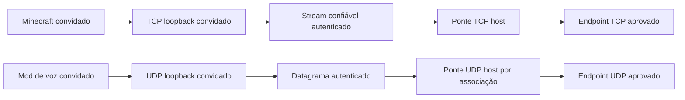

# Aurora Connect V2 — especificação candidata

Revisão: 29/09/2026. **HIPÓTESE** arquitetural; capacidade Aurora Connect: **NÃO IMPLEMENTADO** na inspeção limitada. Não é anúncio de suporte. Base documental: alpha.14, `6a107b87adc4882bd464909e22650185f862ea5e`; Core 1.1.5 e Skins 0.3.1. [Diagnóstico, autoridade e rastreabilidade](../task-aur-r4-connect-v2-review.md), [roadmap](MASTER_ROADMAP.md), [ADR proposta](ADR/PROPOSAL-aurora-connect.md), [tarefas e testes](CODEX_TASKS/AUR-R4-CONNECT-BACKLOG.md), [dependências/custos](AURORA_CONNECT_DEPENDENCIES.md).

## 1. Escopo e autoridade

“Aurora Connect” é nome de trabalho da conectividade R4. Os requisitos V2 são normativos para esta proposta; campos, limites e módulos abaixo são propostas sujeitas à auditoria do código e à decisão arquitetural. Referências externas demonstram possibilidades upstream, não integração nem homologação do Aurora. Esta entrega altera apenas documentação.

O host compartilha um servidor ou mundo com convidados autorizados; o servidor Minecraft continua autoritativo. P2P descreve o caminho de rede. O computador anfitrião e seu agente precisam permanecer disponíveis; não há hospedagem oficial 24 horas. Não se acessa um servidor privado sem cooperação do responsável.

| Modo | Capacidade necessária | Limite |
| --- | --- | --- |
| Servidor público alcançável | Conexão Minecraft normal e endpoints de mods válidos | Não exige túnel nem agente no servidor; não promete corrigir serviço de voz privado |
| Servidor privado compartilhado | Agente no host, autorização de destinos e convites | Só serviços explicitamente aprovados; host disponível |
| Dedicado local | Processo servidor já preparado e endpoints verificados | Preparação/gestão do servidor separada do transporte |
| Singleplayer aberto para LAN | Mundo efetivamente aberto, porta real descoberta, adaptador compatível | Abrir LAN não é auto-join; fechar mundo invalida sessão/portas |

Transporte, descoberta de porta, abertura para LAN, auto-join, presença e sincronização de modpack são capacidades distintas. A PoC pode exigir endereços explícitos e troca manual de identidade; isso não cumpre a experiência final automática. O fluxo suportado final não exige VPN externa instalada manualmente, driver, administração permanente nem ajuste manual de portas.

## 2. Fronteiras e integração existente

Stack confirmada pelos manifests: React 19/TypeScript, Tauri 2 e Rust. Go não é dependência aprovada. Quinn transitivo no lockfile não significa transporte Connect existente. O IPC Core é WebSocket local autenticado, permanece local, com contrato público preservado.

Separar responsabilidades com módulos pequenos conforme a necessidade demonstrada:

1. Identidade/autorização: vincular conta quando aplicável, chave do peer, sessão, convite e permissões.
2. Sinalização: trocar metadados estritamente necessários entre participantes autorizados.
3. Descoberta/NAT traversal: localizar endpoints e negociar caminhos, sem duplicar mecanismos da biblioteca.
4. Transporte: conexão autenticada e cifrada, streams confiáveis e datagramas limitados.
5. Registro e pontes: resolver somente IDs de serviços aprovados pelo host.
6. Adaptadores Minecraft/mods: descobrir serviços e informar destino correto ao cliente.
7. Interface: consumir eventos reais do backend; não inventar progresso.

Local candidato de implementação, **novo e proposto**: `apps/desktop/src-tauri/src/engine/connect/`. A escolha final deve seguir a organização existente; não criar um framework de plugins genérico. `App.tsx`, `commands.rs` e `apps/edge-proxy/src/index.ts` mantêm proprietário exclusivo por wave. Core não ganha Assistente in-game, HUD ou Companion.

Na alpha.14 já há recovery/CAS restrito, Doctor, Tools confirmadas e cópias de teste. Reutilizar identidade, locks, snapshots e executor quando o escopo for compatível, sem reimplementar esses recursos. O CAS atual não protege automaticamente mundos, `serverconfig` em `saves`, segredos ou todo formato de configuração. Expandir escopo exige contrato e teste próprios; não chamar backup parcial de backup integral.

## 3. Fluxos e registro de serviços

Respostas percorrem o fluxo correspondente em sentido inverso até o mesmo convidado/serviço. O transporte autentica e cifra entre os agentes inclusive via relay. A ponte local opera bytes da aplicação, não pacotes TCP/IP de uma VPN.

Contrato lógico v1 **proposto**, não schema/API já existente:

| Campo candidato | Significado/validação |
| --- | --- |
| `schemaVersion`, `serviceId` | Versão explícita e ID opaco único na sessão; rejeitar versão desconhecida |
| `protocol` | Enum fechado `tcp` ou `udp`; mesmo número de porta não une protocolos |
| `hostEndpoint` | Endereço literal/porta local aprovados pelo host; fica no host, não é escolhido pelo convidado |
| `permissions` | Participantes autorizados e ações connect/send; vinculados à sessão |
| `limits` | Conexões/associações, bytes, taxa, MTU útil e política de filas |
| `requiredCapability` | Stream confiável ou datagramas; recusar capacidade ausente |
| `adapter` | ID e versão do adaptador homologado, ou endpoint controlado de laboratório |
| `revision` | Geração da aprovação; mudar destino invalida associações anteriores |

Confirmar nomes com os contratos do repositório antes de implementar. Catálogo público ao convidado omite endpoint do host e só revela serviços autorizados. A abertura referencia `(sessionId, serviceId, revision)`; não aceita IP, URL ou porta arbitrários. Host confirma o destino após conferir processo/instância, configuração efetiva e permissão. Manifesto, metadado de mod ou resposta da IA apenas propõem serviços; nunca concedem acesso.

MVP limita destinos a loopback do próprio host. Um bind específico em interface local precisa de confirmação e allowlist de endereços realmente locais; endpoint LAN em outra máquina não entra implicitamente. Não há SOCKS, proxy aberto, encaminhamento geral à LAN, execução remota ou exposição automática de RCON, SSH, banco de dados e painéis. Não resolver nomes controlados pelo convidado, evitando SSRF/DNS rebinding.

## 4. TCP: contrato verificável

Um TCP aceito no convidado corresponde a um stream bidirecional e uma conexão TCP no host. Status/ping Minecraft e jogo têm conexões independentes. Cabeçalho inicial limitado abre o serviço; só após autenticação, autorização e resposta de abertura os bytes são entregues ao endpoint. O stream de controle é separado do conteúdo.

Preservar ordem e integridade em cada direção. Ler de uma ponta conforme capacidade limitada de escrita na outra: backpressure, sem buffer ilimitado nem descarte de bytes. EOF em uma direção termina a escrita correspondente (half-close) quando a biblioteca suportar; cancelamento/erro fatal encerra o par, libera recursos e informa causa sanitizada. Testar shutdown parcial, erro de escrita, slow reader, streams simultâneos e cancelamento durante abertura e tráfego. Não reenviar automaticamente uma sessão Minecraft interrompida nem duplicar bytes após reconexão.

O certificado/chave deve corresponder à identidade esperada; nunca usar verificador que aceite qualquer certificado. Não enviar TCP como UDP sem confiabilidade. Não interpretar nem substituir bytes dentro do fluxo Minecraft cifrado para alterar voz/endereço.

## 5. UDP: associações, retorno, MTU e filas

Cada listener loopback pertence a uma instância, sessão e serviço. No convidado, a associação considera endereço/porta de origem local e uma geração; no transporte, `(peer autenticado, sessionId, serviceId, associationId, generation)`. O host cria um socket UDP conectado ao endpoint aprovado **por associação** como padrão inicial. O retorno desse socket determina inequivocamente o participante e serviço. Multiplexar todos em um socket compartilhado fica proibido até existir demultiplexação específica comprovada. O mod do host verá origem da ponte, não o IP original: funções dependentes desse IP precisam de análise, sem inventar identity forwarding.

Abrir/fechar associação usa controle confiável com autorização e limites. Datagramas recebidos antes da abertura, de serviço/generation inválidos ou após revogação são descartados com contador limitado. Um datagrama de aplicação corresponde a uma unidade entregue intacta; não concatenar, truncar ou prometer ordenação/confiabilidade que UDP não oferece. Preservar datagramas de tamanho zero se o adaptador os permitir. Identificadores não autorizam nada sozinhos: são escopados à conexão autenticada.

Avaliar QUIC DATAGRAM ou equivalente real. RFC 9221 não fornece fragmentação do frame nem flow control por associação; o controle de congestionamento é do transporte. O Aurora deve limitar filas e multiplexar serviços explicitamente. ACK do transporte não demonstra reprodução de voz. [RFC 9221, §§4–5](https://www.rfc-editor.org/rfc/rfc9221.html), consulta 29/09/2026.

Enquadramento binário candidato v1: versão 1 byte, flags 1, service handle 4, association handle 8, geração 4, sequência de observação 4 e comprimento 2: **24 bytes**, todos autenticados pelo transporte. Handles são locais à sessão negociada; números de rede em big-endian; comprimento deve coincidir exatamente. A sequência serve a métricas/janela contra duplicações do envelope e não impõe entrega ordenada. Rejeitar tipo/flags desconhecidos. Confirmar formato somente na decisão de implementação, com testes de serialização/fuzz; não é API upstream.

Orçamento com unidades explícitas: `B` é o máximo de bytes disponíveis no datagrama útil da biblioteca para o envelope Aurora inteiro; `H = 24` é o cabeçalho proposto; `S` é o teto de bytes de aplicação do serviço. Exigir suporte DATAGRAM e `B >= H` antes de subtrair; então `máximo aplicação = mínimo(S, B − H, 65535)`, respeitando também o máximo UDP da família usada. Ausência de capacidade/limite menor que H é incompatibilidade, nunca underflow. O limite da biblioteca já deve refletir o caminho e overhead de QUIC; não subtrair nem ignorar esse overhead duas vezes. Recalcular quando o caminho mudar. Se a API não expuser garantia suficiente, usar limite conservador demonstrado por teste e declarar o alcance. MTU IP, payload UDP externo, frame DATAGRAM e payload do mod são medidas diferentes.

Recepção local usa buffer capaz de detectar datagrama maior que o teto (até o máximo da família UDP suportada), sem encaminhar prefixo truncado. Oversize gera erro/contador e torna a compatibilidade indisponível; não derruba o jogo. Medir tamanhos do UDP integral dos mods, sem armazenar seu conteúdo. O `mtu_size` documentado no Simple Voice Chat não é prova do tamanho final do pacote encapsulado. Reduzir configuração só após avaliar protocolo/versão com plano/diff e autorização. Não cabe presumir que todo áudio cabe em 1200 bytes.

Primeira PoC não fragmenta. Se necessário para um mod real: decisão separada com ID único por mensagem/geração, limites de fragmentos/total/associações/bytes em remontagem, validação antes de reservar memória, janela/expiração curta, descarte integral em perda/duplicação inconsistente e testes de abuso. Só entregar ao socket local após remontagem completa; fragmentos permanecem autenticados pelo transporte. Sem esse projeto validado, declarar incompatibilidade. Não reimplementar criptografia ou congestionamento.

Limites iniciais de laboratório **propostos**, ajustáveis mediante medidas e nunca SLA:

| Recurso | Teto inicial | Ao exceder |
| --- | --- | --- |
| Sessões/participantes | 1 sessão host, 8 convidados | Recusar nova admissão |
| Serviços | 8 por sessão | Recusar registro |
| TCP | 16 streams/peer, 64 na sessão; buffers 64 KiB por direção | Backpressure; recusar abertura adicional |
| UDP | 16 associações/peer, 128 totais; o menor limite do adaptador prevalece | Recusar nova associação |
| Controle | Mensagem 16 KiB, 20 mensagens/s/peer, burst 40 | Recusar/fechar abuso persistente |
| UDP por serviço/peer | 200 datagramas/s, burst 40; 2 Mbit/s | Descartar excedentes, diagnóstico agregado |
| Banda agregada | 20 Mbit/s por sessão de laboratório | Limitar admissão, TCP com backpressure, UDP conforme política |
| Memória Connect | 32 MiB de buffers/associações de aplicação por sessão | Recusar recursos; medir separadamente memória da biblioteca |
| Abertura/expiração | Handshake 10 s; associação inativa 30 s; sessão ociosa 120 s | Fechar e liberar; negociar política adequada ao serviço |

Esses limites não afirmam que atendem a oito jogadores/mods; AUR-R4-003/004 deve medi-los e ajustá-los. Limite de datagrama depende do caminho e do serviço, não de um número universal. Keepalive documentado do mod pode exigir ajuste da expiração. Revogar convite/fechar mundo/encerrar processo libera imediatamente listeners, sockets, tasks e filas, independentemente do timer.

Voz: fila inicial até 8 datagramas ou 40 ms de permanência local, o menor limite; descarte de vencidos/mais antigos, métricas separadas. Não analisar áudio para decidir. Outros serviços UDP recebem política explícita própria; a política de voz não é herdada automaticamente. O transporte pode guardar dados internamente; verificar limites/TTL reais e não prometer que descartar na aplicação remove áudio já enfileirado num relay TCP.

Streams e voz podem compartilhar conexão se houver isolamento e métricas adequadas. Comparar conexão única com conexões separadas por serviço, observando contenção, prioridade e justiça. Separar conexão não remove gargalo da rede. Não forçar um único socket como dogma.

## 6. NAT, caminhos e política de custo

Preferir direto e permitir relay gratuito **verificado e autorizado para o uso pretendido**. Sem contratação, cobrança automática, cartão/billing ativado, VPS obrigatória, promoção temporária, contas rotativas ou contorno de quota. Software livre não garante servidor gratuito. Alerta/contador/spend cap não comprovado não bloqueia cobrança. Se nenhum relay atende distribuição, liberar no máximo modo direto homologado com limitação clara; demais capacidades seguem experimentais e desligadas.

Iroh é a primeira alternativa a avaliar, não decisão antecipada de produção. Sua conexão pode começar por relay autorizado e buscar direto em paralelo; “direto preferencial” não obriga demora artificial. Sinalização Aurora autoriza sessão, descoberta resolve identidade para endereços, observação de endereços auxilia NAT e relay transporta dados: registrar cada serviço externo mesmo quando integrado. Não adicionar ICE/STUN redundante ao Iroh.

Avaliar LAN, IPv6 com firewall, IPv4 alcançável, hole punching e mapeamento opcional. PCP/NAT-PMP/UPnP ficam desabilitados até consentimento, concessão limitada, registro de propriedade e limpeza ao encerrar; não limpar mapeamento alheio. Verificar defaults da biblioteca. Mapeamento doméstico não remove CGNAT. Timeout sozinho não identifica NAT simétrico/CGNAT.

Para Quinn, demonstrar descoberta/traversal/relay que faltam ao transporte; para ICE + QUIC, provar que o caminho selecionado é o usado, quem lê o socket e como STUN/QUIC são demultiplexados. Não conectar bibliotecas só por assinatura parecida de socket. Go sidecar só se vantagem concreta compensar build, distribuição, assinatura, updater, IPC local autenticado, versões, supervisão e encerramento.

Bloqueio de UDP externo requer caminho realmente alcançável, por exemplo relay HTTPS/WebSocket quando suportado pela versão. QUIC encapsulado em TCP pode sofrer retenção por retransmissões e piorar áudio. Relay apenas UDP não resolve. Medir migração, interrupções, mudança do teto de datagramas e ausência de relay; não prometer transição imperceptível, anonimato, conectividade universal ou ping equivalente ao direto. Dependências e termos na [matriz](AURORA_CONNECT_DEPENDENCIES.md).

## 7. Simple Voice Chat e Plasmo Voice

Integrar transporte de mods existentes é requisito R4. Criar codec, capturar, gravar, transcrever ou analisar voz própria não faz parte do Connect. Homologar os dois mods separadamente; não exigir coexistência. Não baixar/redistribuir JARs sem origem, licença e autorização conforme updater/CurseForge.

Para cada versão registrar três endereços: **bind real do serviço no host**, **destino anunciado ao cliente** e **listener loopback individual do convidado**. Porta TCP do jogo e porta UDP do mod são serviços independentes, mesmo quando têm o mesmo número. Descoberta usa configuração efetiva e API documentada, não nome de mod ou porta padrão fixa.

Simple Voice Chat: investigar `bind_address`, `port`, `voice_host`, auto-porta e diferenças dedicado/LAN na versão selecionada. O `VoiceHostEvent` oficial expõe jogador e alteração de endereço anunciado; é candidato para seleção por participante, não autorização para modificar qualquer versão. Há também API de inicialização de socket cliente. Fixar artefato/API e validar loader antes de compilar add-on. `voice_host` global apontando loopback só funciona onde a ponte correspondente existe. [Configuração](https://modrepo.de/minecraft/voicechat/wiki/server_config), [proxy](https://modrepo.de/minecraft/voicechat/wiki/proxy_setup), [VoiceHostEvent](https://voicechat.modrepo.de/de/maxhenkel/voicechat/api/events/VoiceHostEvent.html), consultados em 29/09/2026.

A página SVC consultada limita `port`, `bind_address` e `voice_host` à configuração do dedicado; usar uma trilha própria para LAN. Ela documenta `mtu_size` com 1275 bytes para pacotes de áudio, o que não comprova o total UDP encapsulado. O guia de proxy também tem comportamento específico de plugins Minecraft: não confundir o agente Aurora com Velocity/BungeeCord. A FAQ não oferece suporte oficial aos túneis e4mc/World Host; isso não os proíbe, mas impede alegar homologação upstream. [Configuração](https://modrepo.de/minecraft/voicechat/wiki/server_config), [proxy](https://modrepo.de/minecraft/voicechat/wiki/proxy_setup), [FAQ](https://modrepo.de/minecraft/voicechat/faq), consulta 29/09/2026.

Plasmo Voice: investigar `[host]` e `[host.public]`, porta efetiva e instância servidor integrado segundo a versão. A API 2.1.17 oferece `UdpClientConnectEvent` e `UdpClient`; substituição do cliente UDP é um ponto de extensão candidato, não prova de suporte a redirecionamento por participante pronto. A decisão deve preservar handshake, secret e demais mensagens. Não inventar `setPublicAddress` por jogador. [Endereçamento](https://plasmovoice.com/docs/server/advanced/), [evento na tag 2.1.17](https://github.com/plasmoapp/plasmo-voice/blob/2.1.17/api/client/src/main/java/su/plo/voice/api/client/event/socket/UdpClientConnectEvent.java), consulta 29/09/2026.

No exemplo documentado do Plasmo, `port = 0` reutiliza o número da porta do Minecraft para UDP; não une TCP e UDP. Confirmar esse significado e o arquivo ativo no artefato escolhido. A versão 2.1.17 pesquisada e a API SVC observada não fixam a versão dos testes Aurora; a seleção final deve existir para um par já permitido na matriz.

Preferência de integração: configuração reversível documentada se suficiente; depois API/add-on oficial. Um hook mínimo Core é último recurso justificado, com contrato local por sessão/instância, capability negociada, destino loopback verificado, restauração/encerramento e matriz afetada. Nome de mensagem e símbolo são **propostos** até confirmação no código; não reutilizar nonce IPC como convite remoto. Não é requisito da PoC TCP/UDP controlada.

| Cenário | Estratégia candidata | Gate |
| --- | --- | --- |
| Todos via Aurora | Destino por cliente para porta reservada da sua ponte; global apenas se comprovadamente aplicável | Conflitos, reinício, múltiplas instâncias e credenciais do mod testados |
| Mistura diretos/Aurora | Endereço externo preservado para diretos; API por jogador ou add-on cliente para Aurora | Sem adaptação comprovada, modo misto não anunciado |
| LAN | Descobrir porta após abertura e acompanhar fechamento/reabertura | Não aplicar configuração exclusiva de dedicado ao mundo LAN |
| Porta local ocupada | Bind efêmero/reserva atômica e informar nova porta ao adaptador | Se mod não aceita porta variável, declarar restrição; não matar outro processo |

Não mudar globalmente `127.0.0.1` sem verificação de cada cliente, inclusive jogador do host. Vincular jogador do Minecraft/voice à autorização Aurora exige mecanismo real, não confiar em UUID enviado sem prova. Preserve autenticação e criptografia do mod e `online-mode`; a autenticação Connect não autentica Minecraft. APIs de socket não autorizam entregar segredos a peers/logs. Host pode operar múltiplas sessões do launcher: listeners e configurações são associados à instância e geração, nunca estado global compartilhado.

Alteração de arquivo: ler/hash → plano/diff mínimo → autorização apropriada → snapshot → revalidar sob lock → escrita transacional → registrar bytes anteriores e escritos. Restaurar apenas se hash/estado atual ainda coincide com a escrita Aurora; divergência exige revisão/mescla, nunca apagar edição concorrente. Preservar comentários/valores do usuário quando o formato permitir. Configuração fora do escopo recovery atual exige mecanismo estreito revisado, sem ampliar silenciosamente o CAS nem expor segredos.

## 8. Ameaças, sinalização e privacidade

Convite candidato contém sessão, host key, guest key autorizado (ou vínculo após aceitação explícita), serviços/revisões, emissão, expiração, ID aleatório de uso único e geração de revogação; assinatura/verificação por biblioteca mantida. Canonicalização e domínios de assinatura precisam de especificação/testes. O canal autenticado deve provar posse da chave ligada ao convite. Não aceitar certificado qualquer, confiança só por nome ou credencial bearer reutilizável como identidade suficiente. Desabilitar 0-RTT para admissão/abertura e tratar replay de aplicação mesmo em transporte seguro. Sessão expira, revogação fecha fluxos e reconexão revalida permissões.

Na PoC, troca manual de chave pública/pin por canal autorizado pode ser usada; não equivale ao login social. Na UX final, demonstrar vínculo conta Aurora ↔ chave de dispositivo com desafio assinado e autorização, recuperação/rotação e rejeição de chave antiga. Não enviar JWT Firebase bruto a peers nem tokens Microsoft/Minecraft a peer, relay ou logs. O servidor Minecraft faz sua autenticação própria; o fluxo offline observado no código precisa de auditoria específica antes de prometer auto-join online.

| Ameaça | Controle/aceite |
| --- | --- |
| Peer intruso, convite adulterado/expirado/revogado, replay | Verificação criptográfica, sessão/key binding, geração e cache de uso único limitado; zero bytes ao host antes da aprovação |
| Destino arbitrário/proxy aberto | Registro local fechado, revisão do host, recusa de parâmetros de rede do convidado |
| Amplificação UDP e exaustão | Autenticação antes de associação, quotas por peer/serviço, destino conectado, limites de respostas e bytes; serviço abusável exige limite específico |
| Processo local forjando cliente | Loopback não é identidade de processo; isolamento por instância, conexão previamente autorizada e autenticação do jogo/mod preservada; não prometer proteção contra usuário local comprometido |
| Relay/sinalização maliciosos | E2E entre peers, validação do destinatário e dados assinados; reconhecem metadados e podem negar serviço |
| Exposição de conta/IP/voz | Redação antes de exportar logs, retenção mínima, sem conteúdo de áudio ou tokens; direto revela IP ao peer |
| Configuração concorrente/supply chain | Snapshot e comparação de hashes, licença/proveniência por artefato, pin e revisão de dependências |

Firestore e Worker existentes são candidatos somente após verificar contratos, rules, plano e quotas efetivos. Não criar backend Functions paralelo nem secret administrativo no app. Se um provedor só aceitar chave global, não distribuir a chave: credenciais individuais curtas exigem emissor seguro auditado e infraestrutura gratuita verificada; caso contrário o provider fica desabilitado.

Sinalização candidata por sessão/participante, sem schema imposto ao backend atual: conta só lê sessões em que participa, host gerencia lista de convidados, convidado escreve apenas sua oferta limitada; campos/chaves/expiração validados. Mensagens até 16 KiB; convite 10 min, negociação 2 min, sessão renovável até 2 h, limites propostos sujeitos à auditoria. Expiração lógica nega imediatamente mensagens antigas; limpeza física tem retenção máxima proposta de 24 h e executor/quotas a validar. Não afirmar que TTL pago do Firestore é grátis. Sem limpeza viável, sinalização em nuvem não é liberada.

Rules testáveis: negar lista global/enumerar usuários, participante removido, escrita como host alheio, excesso de campos/bytes, expiração forjada e leitura após revogação; permitir só o fluxo documentado. Presença tem debounce/limite de listener. Não usar Firestore para bytes de jogo, áudio ou arquivos de modpack. Diagnóstico local usa IDs aleatórios, contadores/códigos e durações; compartilhamento remove endereços, nomes e segredos antes da saída. Sem gravação/captura de áudio.

## 9. Experiência e evidências

Fluxo: preparar servidor/mundo → criar sessão → autorizar convidado → negociar → validar jogo e serviços → entrar. Separar capacidade do transporte, estado do jogo e de cada mod; falha da voz não fecha jogo saudável. Cancelamento retorna estado real e limpa recursos.

| Rótulo de interface | Evidência mínima do backend |
| --- | --- |
| Preparado | Processo/endpoint e configuração conferidos; não basta existir arquivo |
| Convidado autorizado | Convite válido vinculado ao peer e serviços aprovados |
| Túnel conectado | Handshake cifrado + identidade + autorização completados |
| Direto / Relay gratuito | Informação atual de caminho da biblioteca e provider aprovado; se ausente, “caminho não confirmado” |
| Servidor acessível | Resposta válida de status do jogo pela ponte; não é entrada no mundo |
| Jogador no mundo | Evento de runtime suportado vinculado à instância/jogador; IPC conectado sozinho não serve |
| Voz conectada | Handshake/estado oficial do mod identificado, separado de tráfego UDP |
| Voz validada | Teste bilateral documentado com consentimento, sem gravação, ou evidência equivalente de API homologada; nunca timer/ACK QUIC |

Erros distintos conforme evidência: mod ausente, versão não homologada, endereço não configurável, porta ocupada, serviço recusando conexão, credencial inválida, datagrama grande, quota explícita, relay indisponível e conectividade não estabelecida. Timeout genérico não vira diagnóstico “CGNAT restritivo”. Se apenas jogo funcionar, exibir voz indisponível e instrução específica; não declarar sessão integralmente homologada.

## 10. Validação, incrementalidade e liberação

Ordem candidata: inventário/ADR → TCP autenticado → UDP simultâneo controlado → redes reais/relay verificado → Minecraft/convites/estados → SVC e Plasmo separadamente → robustez, manifesto e liberação. Reordenar se código/evidência mostrar incremento já pronto ou bloqueio mais importante; não refazer recovery/Doctor/Tools alpha.14. Testes completos e tarefas estão no [backlog](CODEX_TASKS/AUR-R4-CONNECT-BACKLOG.md).

Cobertura mínima: TCP integridade/isolamento/half-close/cancelamento/backpressure/auth negativa/destino proibido; UDP bidirecional/fronteiras/retorno de vários peers/perda/reordenação/duplicação/MTU/saturação/expiração; jogo+voz sob carga; portas e múltiplas instâncias; convite inválido/replay/revogação; config com edição concorrente/restauração; quota/relay indisponível; IPv4/IPv6/LAN/NAT duplo/CGNAT/UDP bloqueado; redes distintas BR–BR e BR–EUA com ambiente autorizado e sem custo. Testar dedicado e LAN somente onde versão/mod suportarem, modo misto somente se anunciado.

Métricas por cenário e versão: tempo até autenticar/conectar/jogar/voz, RTT do transporte, jitter/perda de probes sem conteúdo, CPU/RAM/banda e estabilidade. Atraso percebido de áudio requer método distinto e consentimento, sem gravar voz; não inferir esse atraso a partir de RTT. TPS/MSPT do servidor só quando produtor real disponível, sem reativar telemetria Companion. Registrar amostras, duração, topologia, método e dados brutos sanitizados; metas numéricas só após baseline, sem ganhos de ping inventados.

Loopback prova ponte; LAN prova alcance local; mocks provam lógica; nenhum prova NAT real. PoC TCP não aprova UDP, voz, relay ou R4. Recursos não validados permanecem experimentais e desativados ao usuário por padrão. Gates R0/R1/R1.5/R2/R2.5/R3 e R5 continuam aplicáveis ao produto; sincronização por manifesto exige origem, integridade, licença, diff, consentimento e rollback, nunca envio arbitrário de modpack pelo túnel/Firestore. R3 não precisa ser refeito para uma PoC isolada de bytes, mas não pode ser ignorado para sync público.

## 11. Referências e limites da pesquisa

Data de acesso: **29/09/2026**. [Iroh relays](https://docs.iroh.computer/concepts/relays), [NAT traversal](https://docs.iroh.computer/concepts/nat-traversal), [Connection](https://docs.rs/iroh/latest/iroh/endpoint/struct.Connection.html), [RFC 9221](https://www.rfc-editor.org/rfc/rfc9221.html), [SVC proxy](https://modrepo.de/minecraft/voicechat/wiki/proxy_setup), [SVC configuração](https://modrepo.de/minecraft/voicechat/wiki/server_config), [Plasmo endereçamento](https://plasmovoice.com/docs/server/advanced/). Referências de API latest são pesquisa; implementar apenas contra versão fixada/lockfile e licença conferida, não copiar símbolos de latest para versão antiga. A [matriz externa](AURORA_CONNECT_DEPENDENCIES.md) registra versões observadas, políticas e incertezas. Nenhuma versão de mod, caminho NAT, relay ou áudio recebeu homologação Aurora nesta revisão.
