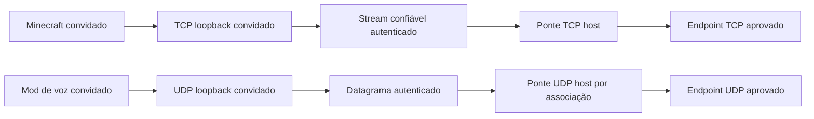

# Aurora Connect V2 — especificação canônica e escopo experimental

Evidência externa23/10: [retomada85](../aurora-connect-external-invites-85.md) acrescenta admissão assinada, replay recusado, TCP1MiB/direção e revogação de conexãoQUIC ativa apósEOF TCP, em tentativas próprias entre outroPC/outra internet. Falhas preservadas e negativo120s antesadmissão; expiração ativa e UI continuam pendentes. Não muda contratos, clocks, transporte ou política de custos. Direto continuaPARCIAL; não é ensaio dos perfis nativos85D/E.

Checkpoint23/10/2026: [contrato86](../aurora-connect-native-voice-host-binding.md) aprovado integralmente por root/QA sobre `dbca5b2`, após85C1/D/E. Autoriza somente incrementos Rust privados Windows/default-off do vínculo nativo e retirada terminalUDP por lease.86 ainda **NÃO IMPLEMENTADO / PRECISA DE TESTE**;86A0 começa pela reserva→execução do mesmo QueryJob84 e binding fraco do mesmoRun, sem Host/convite/UI.86A/86B exigem conjuntamente todas as provas do contrato, sem mudar preimagens antigas, limites ou anúncio.

Reconciliação: 29/09/2026, base cumulativa alpha.14 em `5ac2f7e288e77fbb0d5c0d7adbe057f6f76c52a6`; Core 1.1.5 e Skins 0.3.1. O contrato experimental abaixo substitui as propostas anteriores nos pontos divergentes; produto, redes externas e mods sem evidência continuam **HIPÓTESE / PRECISA DE TESTE**. Não é anúncio de suporte. [Reconciliação](AURORA_CONNECT_REVIEW.md), [rastreabilidade](AURORA_CONNECT_TRACEABILITY.md), [execução e estado real](../task-aur-r4-connect.md), [roadmap](MASTER_ROADMAP.md), [ADR](ADR/PROPOSAL-aurora-connect.md), [tarefas e testes](CODEX_TASKS/AUR-R4-CONNECT-BACKLOG.md), [dependências/custos](AURORA_CONNECT_DEPENDENCIES.md).

## 1. Escopo e autoridade

85D/E encerram separadamente os ensaios locais reais do [contrato85](../aurora-connect-native-voice-runtime.md), em estado **PROTÓTIPO de dedicado nativo com configuração e binding UDP observados**. Windowsx64/Minecraft1.21.1/Fabric0.16.14/JDK21.0.12.1: SVC2.6.22, quarta tentativa total/primeira corrigida, **1 PASS/66,15s**; Plasmo2.1.17 + Fabric API0.116.10, primeira tentativa, **1 PASS/70,83s**. Cada perfil teve nova factory/cópia e duas revisões concretas, STATUS767/pong, TCP e UDP85 Ipv4Literal do mesmo Child, configuração viva DefaultUnchanged e completion83/84 original Requested/exit0/não forçada/reaped/readers completos. EULA restaurada com mesmos ID/bytes; catálogo/recursos/origem preservados, todos os postchecks verdadeiros e22/24 leituras READ/share0 após completion com controle/fontes vivos. As amostras não atribuem o socket ao mod nem concedem vínculoHost, ponte, autenticação ou áudio.

Precisão§9 aprovada root/QA no SHAcf1e431bae19f5efc5a7807b507482385858eeb55a5397623d7da128af242cca antes do fix: somente Recipe::voice_production/VoiceV2 acrescenta o argumento literal `-DbundlerRepoDir=.connect-run-temp` na posição5, para a própria temp nova/fixada antes de MayHaveSpawned. DigestV2 vincula o argumento; RecipeV1/wire/argv/env/limites e catálogos mods/libraries fechados não recebem exceções. O registroC1 abaixo permanece o checkpoint anterior à variaçãoV2. Focais existentes8 pré-spawn PASS203,01s/compilação2m54s e8 contexto PASS20,55s/compilação1,35s; dez goldensV1 antigos em um opt-in PASS0,07s/compilação1,34s. Clippy all/default/connect PASS24,63s/2,45s/1,61s; fmt PASS silencioso. Os opt-ins reais usaram perfil otimizado do teste, compilaçõesSVC1,36s/Plasmo1,19s, sem release/publicação de produto. Dois novos pais ignorados executados separadamente; nenhum pai ativo novo ou full anterior reatribuído. FalhasSVC anteriores ficam preservadas: Expired sem Java, aprovaçãofactory tardia sem cópia e Context(Identity) após extração em libraries. A terceira cópia permanece NeedsRecovery, com Java já recolhido; não foi reparada pelos novos PASS. [Task](../task-aur-r4-connect.md) conserva comandos, métricas e evidências. Draft86 não aprovado/não registrado; login/mundo/GUI/redes externas, nove pares e áudio por mod mantêm gates próprios, features default-off, Assistente e zero gasto preservados.

85A acrescenta consulta UDP separada sob o proprietário83 e suas reservas/gates existentes. [Contrato85](../aurora-connect-native-voice-runtime.md). **PROTÓTIPO**, focais corrigidos18 discovery/39 owner PASS; full e checks no task. Consulta ambas famílias com limites conjuntos e unicidade conservadora da porta. Só linhaOS literal é qualificada; mapped é classificado internamente, mas recusado `Unavailable` na API real após recheck. Diagnóstico do mesmo Child observou dual-stack mapped no CIM e literal no IPHelper; não trocar providers nem normalizar para aceitar. Gate mapped permanece BLOQUEADO/NÃO VERIFICADO.82/84C, defaults off, matriz e produto preservados; não é ainda fonte/configuração viva, perfilJava/mod ou voz.

85B0 acrescenta provas de compatibilidade antes do codecV2: dez arquivos antigos byte-exatos e replay das mesmas preimagens de produção; baseline13 prefixosV1→V1 passou com paths/IDs/recovery/cleanup originais e novos guard/review. Dois conjuntos separados de13 antigos foram reservados para os refactorsB1/B2. Naquele checkpoint isso não era prova pós-V2 antecipada, perfil/mod/Java/voz ou mudança de produto. Focais/checks e limites no task; Claim/ApprovedFiles/Manifest/domíniosV1 permanecem no formato anterior.

85B1 é **PROTÓTIPO** do codec separado: ManifestV1 mantém bytes/domínios/aceitação lexical antiga e VoiceV2 tem18 campos fechados. Dispatch usa duas passagens sobre os mesmos bytes; V1 conserva arrays posicionais aceitos pelo derive antigo e V2 exige objetos em todas as posições correspondentes.25 pais novos PASS (22codec+3gates), dez goldens persistidos e recovery dos mesmos13 prefixos antigosB1 PASS; a reserva13B2 foi mantida para ApprovedFiles/EULA/factoryV2. Naquele checkpoint, Bundle/STATUS recusavamV2 antes de autoridade/receita, sem admissão física. FullB1 final658 PASS/0 falhas/73 ignorados em oito targets; Clippy all/default/connect e fmt PASS. Não promove perfil/mod, configuração viva, Java, áudio, GUI, rede ou matriz.

85B2 implementa **PROTÓTIPO** de factory privada e EULA file-only para SVC/Plasmo. A admissão físicaV2 valida nomes/conjuntos fechados antes de joins e compara os artefatos com catálogo compilado; a API normal nunca seleciona pins de fixture pelo Manifest, caminho ou cfg(test). ApprovedFilesV2 conserva original/properties/voice_configuration sem tag e exige kind correspondente; novos domínios de factory/EULA/recovery não alteram bytes/domíniosV1 ou Claim1/slots. O baseline compilado e sua mesma Observation autorizam somente a transação de arquivos revisada; STATUS ainda recusaV2 antes da receita.19 pais novos PASS em rodadas18+1, reteste do pai13prefixos por perfil, regressão dedicada79 PASS/0 falhas/8 ignorados e Clippy all/default/connect PASS. Dez goldens antigos e recovery dos mesmos13 prefixosB2 PASS. Dois opt-ins normaisCompiled file-only PASS separadamente: SVC70,12s e Plasmo92,74s, dez verificações finais verdadeiras cada, sem Java/STATUS/áudio/rede. Full658 acima pertence aB1; B2 executou o recorte dedicado e as provas de compatibilidade próprias, sem reatribuir esse full.

No limite file-onlyB2, reopen isolado não abre a configuração mutável. Validate e recovery preservam o inventário readonly transitivo existente, que pode ler/hash a configuração atual e recusar instabilidade/caminhos inseguros. Restauração EULA não exige o ID/bytes/hash antigos da voz nem a reescreve; testes de rewrite/novoID/ausência estáveis não comprovam tolerância a writer concorrente. Não relaxar Recovery global.85C requer contexto imutável separado, sem Bundle.validate/Store/inventário; os draftsC0 então não registrados não concediam configuração viva, execuçãoJava, Host ou áudio. Gates de produto, matriz e defaults continuam preservados.

85C0 implementa **PROTÓTIPO** do leitor/validação privados nos dois caminhos compilados. Pina somente raiz/pais verificados, abre READ/share7/OPEN_REPARSE_POINT, exige regular/single-link e limita256KiB+1. ID/tamanho/criação/última escrita/atributos são conferidos antes/depois no mesmo handle; o primeiro fica vivo durante a reabertura do pathname e comparação final. Erro/replacement não recaptura bytes nem faz retry. A amostra privada contém perfil/revisão/hash, sem handles/path/conteúdo/serde ou permissão. O lexerSVC legado é reutilizado intacto com port43002/bind127/voice_host vazio; childPlasmo conserva preflight antigo e exige três boolfalse/host127/port43003/nenhuma forma de host.public.17 pais novos PASS, regressão Plasmo19 PASS incluindo7 repetidos, três SVC legados exatos e Clippy all/default/connect/fmt PASS. Prova causal de writer+rename durante leitura não é testeJava, snapshot atômico ou prontidão de voz. Naquele checkpoint C1 permanecia integração futura: mesma origem/run/slot/gates e duas amostras ainda eram necessários; sem source/Host/áudio ou novo gate de produto porC0.

85C1 implementa **PROTÓTIPO** de plan_voice_execution para VoiceV2, separado do planejamento STATUSV1. RecipeV1 e sua preimagem conservam bytes/campos/ordem; a tuplaV2 é `(2, "native_voice_execution_v2", review_id, manifest, file_digest, recipe)`, com kind/perfil e deadline originais da preparação. Contexto imutável somente de valores revalida identidades, manifesto limitado, recursos/proveniência e catálogo fechado mods/libraries; não chama Bundle.validate, Store ou inventárioRecovery durante a consulta. Fonte somente Weak compartilha o QueryJob84 e o observer83 originais: TCP → configuraçãoA → UDP85 literal → configuraçãoB → TCP, com amostras iguais e gate final inclusive nos erros. Closed prevalece após selo/cancel/prazo; erro de configuração/UDP não encerra STATUS/jogo. As barreiras de lançamento conservam template e mesma Observation de properties/configuração antes/depois de MayHaveSpawned; conclusão84 aguarda reap/readers83 e o job84 antes da restauração EULA/publicação. Fonte/amostra não concedem Host, áudio, autoria do socket pelo mod ou reativação81; default-off e matriz preservados. 22 pais novos ativos distintos PASS: 8 de contexto imutável, 6 de runtime/lifecycle e 8 de pré-spawn. O helper próprio adicional continua ignorado como teste isolado e é acionado como filho pelos pais, sem entrar nos 22 PASS; filtros, logs e métricas estão no task. Regressão dedicada79 PASS/0 falhas/8 ignorados; dez goldens antigos e verificação dos13 prefixos físicos originais PASS; Clippy all/default/connect e fmt PASS. Tempos, falhas corrigidas e limites estão no task. Resultados e gate de fechamentoC1 no task; ensaiosJava85D/E posteriores.

84A acrescenta factory privada de cópia Doctor e EULA por slots/IDs/claim duráveis, revisão consumível e recuperação com guard real/revisão novos; **PROTÓTIPO** de arquivos,27 focais PASS e opt-in real de arquivos1 PASS, sem Java naquele checkpoint. Lab ancestral vinculado; DB observado sem inicialização/reparo/write, lock comum pode criar arquivo vazio ausente sem truncar; paths longos internos derivados/pinados. Preparação incompleta sem IDs publicados fica NeedsRecovery. Full578 PASS/66 ignorados e fmt/Clippy all/default/connect PASS pertencem a84A, detalhes no task; review EULA-only continua sem autorizar execução/STATUS84C nem voz/GUI/rede. [Contrato84](../aurora-connect-dedicated-status.md).

84C implementa o produtor nativo STATUS privado com revisão de execução própria/mesmo prazo original, ClaimC e ownership original83 até reap/readers/queries/restauração. Estado final **PROTÓTIPO**. Retry de boot limitado apenas ConnectionFailed/Truncated não afrouxa parser/767/pong/provaTCP; teve RED/GREEN causal no mesmo Child. A mesma observação aprovada de server.properties é revalidada antes/depois de MayHaveSpawned e antes de83; os três testes causais passaram de RED0PASS/3falhas para GREEN3PASS/0falhas, preservando a edição e a disposição EULA por fase. Sexto opt-in pós-fix Minecraft1.21.1/Fabric0.16.14/Java21 real1 PASS95,14s, stop normal/exit0 e14 verificações finais verdadeiras. Regressão final pós-fix605 PASS/0 falhas/68 ignorados em oito targets; fmt e Clippy all/default/connect PASS. Comandos, tempos e tentativas anteriores no task. Sem IPC/UI/caller de produção, sem mods externos, áudio ou homologação de jogo/rede; nove pares e features default-off conservados.

Registro histórico do prelude84: estado **PARCIAL** naquele checkpoint, sob o [contrato84](../aurora-connect-dedicated-status.md) aprovado antes do código. Corrigiu readerTCP Windows (returned length/tabela inteira/scopeIPv6/pós-proof), com8 focais/545 regressão PASS e checks/QA. O prelude isolado não implementava EULA/produtorJava/fonteTCP sob83 nem alterava política de descoberta; as entregas posteriores84A/84B/84C são descritas separadamente. Nenhum gate de jogo/GUI/áudio/redes é promovido pelos testes desse reader.

84B implementa amostraTCP interna do Child original sob o mesmo slot/queryJob83 que UDP, prova e decisão final comuns, literal loopback exato e sem normalização. **PROTÓTIPO**,29 focais PASS/1 helper ignorado, checks/QA;545 acima é regressão do prelude anterior. Não concede readiness/ingresso, não é produtor Minecraft e não altera policy de descoberta pública ou gates de voz.

Incremento83 supervisiona um Child nativo próprio, com start interno confiável, runUUID nativo, controle único/observer fraco e conclusão independente do waiter. [Contrato83](../aurora-connect-native-owned-run.md). **PROTÓTIPO**,23 focais/537 regressão PASS e revisão/checks aprovados. Stop sela consultas, recolhe filho/readers antes de esperar query retida e só publica após todos os recursos; saída pré-stop não pode ser normalizada por Requested posterior. Não lança dedicado de produto, valida cópia/Java/EULA ou integra UI/voz; nenhum PID/proof/argv recebido pela interface. Não homologa Minecraft/áudio/redes.

Incremento82 observa binding UDP exato do processo próprio no Windows, por API somente interna e prova original revalidada antes/depois. [Contrato82](../aurora-connect-owned-udp-binding.md). **PROTÓTIPO**,19 focais e regressão514 PASS, com filhos própriosV4/V6 reais; não é produtor dedicado, binding de voz ou prova de recepção/áudio. Decoder limitado pelo comprimento retornado, sem wildcard/mapped/PID frontend. Não reativa serviço retirado81 nem relaxa VoiceMutationGuard. Nenhuma homologação adicional de jogo/interface/rede/mods.

Incremento81 permite ao proprietário nativo desativar permanentemente um serviço UDP exato de uma lease e aguardar sua liberação real sem encerrar TCP/outros serviços/participantes. [Contrato81](../aurora-connect-udp-service-disable.md). Registro antes de I/O, último owner de recurso/payload e gates finais V1/V2 preservam quotas/clocks/consumo/wire. **PROTÓTIPO**, focais, regressões locais e revisão aprovados; nenhum novo caller desktop, notice remoto ou binding de voz. Guest pode conservar sua ponte e bytes já enfileirados podem chegar. Não homologa Minecraft/áudio/redes nem reativa serviço na mesma autoridade.

Incremento80 integra a observação78 nos snapshots e no painel experimental: campo opcional schema1 fechado, individual ou por lease do grupo, sem alterar revisão/digest/exportação, contratos legados ou autorização. [Contrato80](../aurora-connect-desktop-path-observation.md). Fonte original revalidada em cada resposta, sem reter Endpoint; cancelamento/resultado incerto removem a amostra da apresentação. **PROTÓTIPO**, provas locais registradas no task, sem homologação gráfica, Minecraft, áudio ou nova rede. Relay público continua desligado.

Incremento79 remove a retenção de Endpoint pela origem de abertura pronta do Guest. [Contrato79](../aurora-connect-guest-source-cleanup.md). A origem usa referência fraca ao ator e é removida ao encerrar, enquanto workers continuam pertencentes à operação até terminar. **PROTÓTIPO**, com reprodução da falha anterior, rebind causal e regressão local; não homologa launcher gráfico, jogo, voz ou rede externa. Observar caminho não deve recriar esse owner.

Incremento78 observa o caminho selecionado na biblioteca, por API redigida e sem I/O adicional. [Contrato78](../aurora-connect-path-observation.md). direct/relay exigem seleção única inequívoca; unknown preserva ambiguidade, closed respeita cancelamento/autoridade original. Host consulta somente convite consumido e válido. **PROTÓTIPO**, validado em loopback, IPv4 próprio e relay local; a apresentação desktop tem implementação e provas próprias80. Não habilita relay público nem homologa uma rede externa, Minecraft ou voz.

Incremento77 estende o encerramento durante consulta ao ator de grupo. [Contrato77](../aurora-connect-group-source-shutdown.md). O transporte fecha e libera seus owners antes de aguardar a mesma consulta, enquanto cleanup continua pendente. Preserva o roster estrito antes da publicação, autoridades individuais depois dela e histórico cumulativo de consumo/revogação explícita. **PROTÓTIPO**, com provas locais e revisão independente; não amplia homologação de Minecraft, voz ou redes. Evidências e regressão no task.

Incremento76 separa a revisão individual descoberta da consulta bloqueante e conserva seu trabalho no Attempt, inclusive após perda da resposta. As consultas do ator individual observam cancelamento/autoridade e soltam o Host/Endpoint antes de aguardar consulta pendente. [Contrato76](../aurora-connect-owned-source-review.md). Estado **PROTÓTIPO**, testes locais e revisão aprovados; formatos, prazos e aprovação por digest preservados, sem homologação adicional. O monitor de grupo é escopo posterior separado.

Incremento75 corrige a propriedade do preparo descoberto individual48/56/64, reservando a operação antes das consultas. `pendingHostSource` observa trabalho sem chave/socket; três comandos e retorno `ConnectPreparation` preservados. [Contrato75](../aurora-connect-discovery-lifecycle.md). Worker, prazo60s e seleção30s originais independem do waiter IPC; cancelamento/troca de conta aguardam término real. Nova seleção após rejeição exige prova atualizada do manager, nunca reenvio automático. **PROTÓTIPO**, sem ampliar perfis ou homologar GUI, jogo, áudio ou rede externa; provas finais registradas no task.

Incremento74 integra a seleção TCP opaca da descoberta48 ao Host de grupo72, conservando UDP manual e convites individuais. A operação é reservada antes das consultas, com `hostPreparing` sem identidade de transporte e trabalho próprio; encerramento/troca de conta aguardam esse trabalho. [Contrato74](../aurora-connect-discovered-group.md). **PROTÓTIPO**, com provas próprias de origem, cancelamento, três agentes locais e DOM; sem homologação Minecraft LAN/GUI/áudio/rede externa. A feature permanece desligada por padrão; encerramento da origem fecha todos os participantes.

Incremento73 adiciona ação própria para abrir cópia diagnóstica já pronta pela ponte TCP do Guest, sob revisão e consentimento novos. O permit é derivado da conexão/ponte/autoridade originais, revalidado no spawn, sem renovar prazos ou aceitar endereço/argv pela UI. Pré-requisitos ausentes recusam a ação; nenhuma instalação/reparação ou preferência é alterada pelo caller. Somente Fabric1.21.1/0.16.14/Java21, Core1.1.5 e Skins0.3.1 existentes nesta etapa. [Contrato73](../aurora-connect-ready-game-launch.md). Estado de processo iniciado não comprova entrada no mundo, áudio ou GUI; todos os gates e nove pares continuam preservados.

Lifecycle42: fechamento do transporte termina a CLI manual depois de aguardar recursosTCP/UDP, com código estático`closed`/exit1. Stop/prazo locais e contrato dos convites são preservados. Essa distinção informa disponibilidade, sem atribuir causaNAT/inatividade ou imprimir motivo remoto bruto. [Evidências42](../task-aur-r4-connect.md#quadragésimo-segundo-incremento--encerramento-observável-da-cli-manual).

O incremento41 prepara um perfil GUI descartável, separado dos clientes sintéticos: nomes públicos revisados entram na whitelist e nos hashes; plano900s explícito e reuso recusado. Consulte o [contrato runtime](../aurora-connect-runtime.md#cliente-gráfico-externo--preparação41). A prontidão do executor permanece STATUS/bind; mundo renderizado exige relato gráfico correlacionado à presença no servidor, sem promover automaticamente Core/Skins, voz ou contas mistas.

“Aurora Connect” é nome de trabalho da conectividade R4. Os requisitos V2 são normativos. O incremento local usa um contrato único de laboratório; os fluxos futuros de produto permanecem candidatos e não são liberados por esse experimento. Referências externas demonstram possibilidades upstream, não homologação do Aurora. A solicitação atual autoriza implementar/testar localmente por incrementos consecutivos.

O host compartilha um servidor ou mundo com convidados autorizados; o servidor Minecraft continua autoritativo. P2P descreve o caminho de rede. O computador anfitrião e seu agente precisam permanecer disponíveis; não há hospedagem oficial 24 horas. Não se acessa um servidor privado sem cooperação do responsável.

| Modo | Capacidade necessária | Limite |
| --- | --- | --- |
| Servidor público alcançável | Conexão Minecraft normal e endpoints de mods válidos | Não exige túnel nem agente no servidor; não promete corrigir serviço de voz privado |
| Servidor privado compartilhado | Agente no host, autorização de destinos e convites | Só serviços explicitamente aprovados; host disponível |
| Dedicado local | Processo servidor já preparado e endpoints verificados | Preparação/gestão do servidor separada do transporte |
| Singleplayer aberto para LAN | Mundo efetivamente aberto, porta real descoberta, adaptador compatível | Abrir LAN não é auto-join; fechar mundo invalida sessão/portas |

Transporte, descoberta de porta, abertura para LAN, auto-join, presença e sincronização de modpack são capacidades distintas. A PoC pode exigir endereços explícitos e troca manual de identidade; isso não cumpre a experiência final automática. O fluxo suportado final não exige VPN externa instalada manualmente, driver, administração permanente nem ajuste manual de portas.

## 2. Fronteiras e integração existente

Stack confirmada pelos manifests: React 19/TypeScript, Tauri 2 e Rust. Go não é dependência aprovada. Quinn transitivo no lockfile não significa transporte Connect existente. O IPC Core é WebSocket local autenticado, permanece local, com contrato público preservado.

Separar responsabilidades com módulos pequenos conforme a necessidade demonstrada:

1. Identidade/autorização: vincular conta quando aplicável, chave do peer, sessão, convite e permissões.
2. Sinalização: trocar metadados estritamente necessários entre participantes autorizados.
3. Descoberta/NAT traversal: localizar endpoints e negociar caminhos, sem duplicar mecanismos da biblioteca.
4. Transporte: conexão autenticada e cifrada, streams confiáveis e datagramas limitados.
5. Registro e pontes: resolver somente IDs de serviços aprovados pelo host.
6. Adaptadores Minecraft/mods: descobrir serviços e informar destino correto ao cliente.
7. Interface: consumir eventos reais do backend; não inventar progresso.

Local escolhido para o laboratório: `apps/connect-lab/`, crate Rust independente, sem dependência/registro no desktop. Isso permite provar bytes/autorização/TCP/UDP com dois agentes antes de expor qualquer capacidade ao usuário; não cria um sidecar obrigatório do produto nem substitui o IPC local. O antigo caminho candidato `engine/connect/` permanece opção para integração posterior revisada, não segundo transporte ativo. `App.tsx`, `commands.rs` e `apps/edge-proxy/src/index.ts` mantêm proprietário exclusivo por wave. Core não ganha Assistente in-game, HUD ou Companion.

Na alpha.14 já há recovery/CAS restrito, Doctor, Tools confirmadas e cópias de teste. Reutilizar identidade, locks, snapshots e executor quando o escopo for compatível, sem reimplementar esses recursos. O CAS atual não protege automaticamente mundos, `serverconfig` em `saves`, segredos ou todo formato de configuração. Expandir escopo exige contrato e teste próprios; não chamar backup parcial de backup integral.

## 3. Fluxos e registro de serviços



Respostas percorrem o fluxo correspondente em sentido inverso até o mesmo convidado/serviço. O transporte autentica e cifra entre os agentes inclusive via relay. A ponte local opera bytes da aplicação, não pacotes TCP/IP de uma VPN.

Contrato lógico v1 reconciliado para o laboratório; nomes serializados finais e valores efetivos devem coincidir com codec e testes no task:

| Campo candidato | Significado/validação |
| --- | --- |
| `schemaVersion`, `serviceId` | Versão explícita e ID opaco único na sessão; rejeitar versão desconhecida |
| `sessionId` | Identidade aleatória nova por execução do host, vinculada à conexão autenticada/lease; não reutilizar após reinício. Substitui o segundo `sessionEpoch` proposto anteriormente |
| `protocol` | Enum fechado `tcp` ou `udp`; mesmo número de porta não une protocolos |
| `hostEndpoint` | Endereço literal/porta local aprovados pelo host; fica no host, não é escolhido pelo convidado |
| `permissions` | Participantes autorizados e ações connect/send; vinculados à sessão |
| `limits` | Conexões/associações, bytes, taxa, MTU útil e política de filas |
| `requiredCapability` | Enum singular `reliableStream` ou `datagram`: um serviço tem exatamente um protocolo. Capabilities do peer são negociadas separadamente; recusar capacidade ausente |
| `adapter` | ID e versão do adaptador homologado, ou endpoint controlado de laboratório |
| `serviceRevision` | Aprovação do destino independente de `sessionId`; alteração exige nova aprovação e invalida recursos anteriores. Hash de config é privado quando aplicável |

O modelo local `Service` também contém `udp_return_policy`, escolhido exclusivamente pelo host; não é campo do pedido remoto nem alteração do envelope v1. `ReplyBudget` é padrão e `AuthorizedDownstream { bytes_per_second, datagrams_per_second }` exige aprovação explícita do serviço UDP. Mudança de política/orçamento integra a revisão da aprovação, sem opção de ampliação solicitada pelo convidado.

Catálogo ao convidado omite endpoint do host e só revela serviços autorizados. A abertura referencia a sessão autenticada e `(serviceId, serviceRevision)`; não aceita IP, URL ou porta arbitrários. Host confirma o destino após conferir processo/instância, configuração efetiva e permissão. Manifesto, metadado de mod ou IA apenas propõem serviços; nunca concedem acesso. `requiredCapabilities`, `configurationRevision` e `revision` das propostas antigas não são aliases aceitos silenciosamente no pedido remoto; o campo `revision` do modelo/plano local é convertido explicitamente à revisão do serviço, conforme §3.1.

MVP limita destinos a loopback do próprio host. Um bind específico em interface local precisa de confirmação e allowlist de endereços realmente locais; endpoint LAN em outra máquina não entra implicitamente. Não há SOCKS, proxy aberto, encaminhamento geral à LAN, execução remota ou exposição automática de RCON, SSH, banco de dados e painéis. Não resolver nomes controlados pelo convidado, evitando SSRF/DNS rebinding.

### 3.1 Plano local revisado por hash — laboratório

A CLI possui `plan <arquivo>` para prévia sem abrir socket nem escrever arquivo, e `host-plan <arquivo> <sha256-aprovado>` para iniciar exatamente o plano revisado. O hash SHA-256 cobre bytes originais, incluindo espaços e BOM UTF-8; qualquer diferença exige nova revisão. O arquivo é lido uma vez para um snapshot imutável em memória. Hash divergente é recusado antes de `host_identity`/abertura de transporte. Depois da revisão, ainda é necessário autorizar manualmente o pin público do convidado; sessão/chaves são novas por execução.

O schema **local** v1 é estrito e limitado a 16 KiB: `schemaVersion`, `bind`, `durationSeconds` e `services`. O bind de transporte tem porta não zero e não pode ser multicast/broadcast; duração é 10–3600 segundos. Desde o décimo quinto incremento, aceita `game` TCP/reliableStream obrigatório e `aux` UDP/datagram opcional, ambos revisão 1, com destino literal loopback e porta não zero. Plano vazio/somente aux/IDs repetidos continuam recusados; adicionar aux altera o hash e exige nova revisão. A CLI `guest-tcp` anuncia somente reliableStream e não abre associação aux; `guest` conserva ambos. O serviço usa `serviceId`, `protocol`, `endpoint`, `revision`, `requiredCapability`, `maxDatagramBytes` e `udpReturnPolicy` opcional; omissão da política seleciona `replyBudget`. Somente `aux` pode selecionar `authorizedDownstream` com orçamento explícito. Campos desconhecidos em qualquer nível são recusados. Esse plano de configuração não é schema remoto, manifesto de modpack ou convite de produto; QUIC ainda usa UDP como transporte.

Caminho deve ser arquivo local regular dentro dos limites de leitura. No Windows, UNC/dispositivos/ADS e aliases ambíguos são recusados lexicalmente antes de consultar o filesystem; links/reparse points observados são recusados. Essas verificações não constituem sandbox contra toda troca concorrente maliciosa de diretórios. Prévia contém endpoints para revisão local e não é diagnóstico compartilhável. Nenhuma configuração pessoal/mod é escrita: rollback é revogar e encerrar agentes, sem restauração de arquivo que o comando não alterou. [Exemplo concreto](../../apps/connect-lab/examples/host-downstream.json), [procedimento e comandos](../aurora-connect.md).

Evidência do terceiro incremento: onze testes de plano, suíte completa 45/45, fmt/clippy e dois smokes multiprocesso aprovados. O smoke downstream recusou hash zero antes da identidade do host e comprovou 2 bytes UDP enviados/8192 recebidos em 16 respostas de duas origens, além de 1 MiB TCP por direção. O plano de fixture permaneceu inalterado. O ensaio padrão manteve dez UDP e 3138 bytes por direção. Os planos temporários gerados pelo script são fixtures ignoradas, não configurações pessoais.

## 4. TCP: contrato verificável

Um TCP aceito no convidado corresponde a um stream bidirecional e uma conexão TCP no host. Status/ping Minecraft e jogo têm conexões independentes. Cabeçalho inicial limitado abre o serviço; só após autenticação, autorização e resposta de abertura os bytes são entregues ao endpoint. O stream de controle é separado do conteúdo.

Preservar ordem e integridade em cada direção. Ler de uma ponta conforme capacidade limitada de escrita na outra: backpressure, sem buffer ilimitado nem descarte de bytes. EOF em uma direção termina a escrita correspondente (half-close) quando a biblioteca suportar; cancelamento/erro fatal encerra o par, libera recursos e informa causa sanitizada. Testar shutdown parcial, erro de escrita, slow reader, streams simultâneos e cancelamento durante abertura e tráfego. Não reenviar automaticamente uma sessão Minecraft interrompida nem duplicar bytes após reconexão.

O certificado/chave deve corresponder à identidade esperada; nunca usar verificador que aceite qualquer certificado. Não enviar TCP como UDP sem confiabilidade. Não interpretar nem substituir bytes dentro do fluxo Minecraft cifrado para alterar voz/endereço.

## 5. UDP: associações, retorno, MTU e filas

Cada listener loopback pertence a uma instância, sessão e serviço. No convidado, a associação considera endereço/porta de origem local e uma geração; no transporte, `(peer autenticado, sessionId, serviceId, associationId, generation)`. O host cria um socket UDP conectado ao endpoint aprovado **por associação** como padrão inicial. O retorno desse socket determina inequivocamente o participante e serviço. Multiplexar todos em um socket compartilhado fica proibido até existir demultiplexação específica comprovada. O mod do host verá origem da ponte, não o IP original: funções dependentes desse IP precisam de análise, sem inventar identity forwarding.

Abrir/fechar associação usa controle confiável com autorização e limites. Datagramas recebidos antes da abertura, de serviço/generation inválidos ou após revogação são descartados com contador limitado. Um datagrama de aplicação corresponde a uma unidade entregue intacta; não concatenar, truncar ou prometer ordenação/confiabilidade que UDP não oferece. Preservar datagramas de tamanho zero se o adaptador os permitir. Identificadores não autorizam nada sozinhos: são escopados à conexão autenticada.

Avaliar QUIC DATAGRAM ou equivalente real. RFC 9221 não fornece fragmentação do frame nem flow control por associação; o controle de congestionamento é do transporte. O Aurora deve limitar filas e multiplexar serviços explicitamente. ACK do transporte não demonstra reprodução de voz. [RFC 9221, §§4–5](https://www.rfc-editor.org/rfc/rfc9221.html), consulta 29/09/2026.

Enquadramento binário v1 de laboratório: versão 1 byte, flags 1, service handle 4, association handle 8, geração 4, sequência 4 e comprimento 2: **24 bytes**, todos autenticados pelo transporte. Handles são locais à sessão; números de rede em big-endian; comprimento deve coincidir exatamente. A geração coincide com a revisão aprovada do serviço e a associação não é reutilizada na conexão. A janela de 64 sequências admite reordenação, mas descarta envelope duplicado ou antigo; não impõe ordem nem retransmissão. Rejeitar versão/flags desconhecidos. Peer e sessão vêm da conexão autenticada e lease; identidade declarada pelo convidado não autoriza outra associação. Testes do codec fixam esse formato, que não é API upstream. A reserva antiga de até 32 B foi substituída por este formato único.

Orçamento com unidades explícitas: `B = Connection::max_datagram_size()` é o máximo útil da biblioteca para o envelope Aurora inteiro; `H = 24`; `S` é o teto do serviço. Exigir suporte DATAGRAM e `B >= H` antes de subtrair; o laboratório usa `mínimo(S, B − H, 65507)` conservador para UDP. Ausência de capacidade/limite menor que H é incompatibilidade, nunca underflow. O limite da biblioteca já reflete QUIC/caminho; não subtrair esse overhead novamente. Reconsultar antes de envio, inclusive se o caminho mudar. MTU IP, payload UDP externo, frame DATAGRAM e payload do mod são medidas diferentes.

Recepção local usa buffer capaz de detectar datagrama maior que o teto (até o máximo da família UDP suportada), sem encaminhar prefixo truncado. Oversize gera erro/contador e torna a compatibilidade indisponível; não derruba o jogo. Medir tamanhos do UDP integral dos mods, sem armazenar seu conteúdo. O `mtu_size` documentado no Simple Voice Chat não é prova do tamanho final do pacote encapsulado. Reduzir configuração só após avaliar protocolo/versão com plano/diff e autorização. Não cabe presumir que todo áudio cabe em 1200 bytes.

No código atual, o convidado guarda o teto recebido na abertura da associação. `max_payload()` combina esse teto com `Connection::max_datagram_size() − 24` consultado naquele momento; uma redução local pode limitar imediatamente o envio. Crescimento acima do teto recebido exige fechar e abrir outra associação autorizada, com novo ID. A associação antiga não renegocia implicitamente; reabertura não garante aumento. Não confundir teto respondido pelo host na abertura com leitura direta ou contínua da capacidade de transporte do host.

Evidência38, somente `cfg(test)`: dois agentes reais em loopback, TCP1MiB por direção, amostras da capacidade local antes/depois da consulta efetiva para tolerar mudança durante a leitura, teto host antigo/nova abertura, estatísticas numéricas de PMTU/probes e caminho direto. A amostra focada teve capacidade Guest1414B constante (`growth_not_observed`) e resposta Host1358→1390B (`hostOpeningReplyChange=increased`);1390B passou íntegro, tetoHost+1 foi recusado, a associação antiga fechou e todas as portas foram reassociadas após liberação dos handles. Valores são observações, não constantes do contrato, medição de MTU física ou prova de crescimento obrigatório. [Comandos/resultados38](../task-aur-r4-connect.md#trigésimo-oitavo-incremento--orçamento-observado-e-reabertura-udp).

Evidência37 acrescenta fixture/probe nativos `echo-boundary`/`probe-boundary`, sem modificar este transporte: cap de serviço1264 aprovado, quatro ecos exatos, duas tentativas1265up sem chegada ao endpoint, quatro emissões1265down sem chegada ao convidado, duas origens e TCP1MiB/direção progredindo duranteUDP. Retorno usa orçamento downstream explícito; contadores fixos da fixture são lidos por TCP confiável e janelas500ms observam ambos sockets. Endpoints da ferramenta são literais loopback; a topologia externa depende da ponte autenticada e de roteiro separado. TCP cadenciado não prova saturação; emissão noSO não comprova entrega ou motivo individual de descarte. [Evidência37 e limite externo](../task-aur-r4-connect.md#trigésimo-sétimo-incremento--fronteira-nativa-para-preparação-externa).

Evidência39 (01/10/2026) executou esse probe através de uma ponte entre dois computadores/internets distintos, confirmados pelo usuário: cap1264, quatro ecos/duas origens, duas tentativas1265up sem chegada ao endpoint e quatro emissões1265down sem chegada ao convidado; válidos posteriores e TCP1048576B/direção,553898B duranteUDP, cadência200ms/janela500ms. Resultado remoto e guest_stopped vêm do usuário; encerramento/portas livres do anfitrião foram observados localmente. Endereço inicialIPv6 manual não demonstra caminho imutável ou NAT traversal; caminhos/migração não foram instrumentados. A prova não mede MTU física, saturação, desempenho ou UDP integral dos mods, e não modifica o contrato. [Registro39](../task-aur-r4-connect.md#trigésimo-nono-incremento--fronteira-udp-externa-com-tcp-cadenciado).

Primeira PoC não fragmenta. Se necessário para um mod real: decisão separada com ID único por mensagem/geração, limites de fragmentos/total/associações/bytes em remontagem, validação antes de reservar memória, janela/expiração curta, descarte integral em perda/duplicação inconsistente e testes de abuso. Só entregar ao socket local após remontagem completa; fragmentos permanecem autenticados pelo transporte. Sem esse projeto validado, declarar incompatibilidade. Não reimplementar criptografia ou congestionamento.

Limites de produto abaixo permanecem **propostos**, ajustáveis mediante medidas e nunca SLA. O harness pode começar com tetos menores; valores efetivos impostos pelo código são registrados no [contrato operacional](../aurora-connect.md) e no task. Não afirmar que um teto candidato desta tabela foi implementado sem prova:

| Recurso | Teto inicial | Ao exceder |
| --- | --- | --- |
| Sessões/participantes | 1 sessão host, 8 convidados | Recusar nova admissão |
| Serviços | 8 por sessão | Recusar registro |
| TCP | 16 streams/peer, 64 na sessão; buffers 64 KiB por direção | Backpressure; recusar abertura adicional |
| UDP | 16 associações/peer, 128 totais; o menor limite do adaptador prevalece | Recusar nova associação |
| Controle | Mensagem 16 KiB, 20 mensagens/s/peer, burst 40 | Recusar/fechar abuso persistente |
| UDP por serviço/peer | 200 datagramas/s, burst 40; 2 Mbit/s | Descartar excedentes, diagnóstico agregado |
| Banda agregada | 20 Mbit/s por sessão de laboratório | Limitar admissão, TCP com backpressure, UDP conforme política |
| Memória Connect | 32 MiB de buffers/associações de aplicação por sessão | Recusar recursos; medir separadamente memória da biblioteca |
| Abertura/expiração | Handshake 10 s; associação inativa 30 s; sessão ociosa 120 s | Fechar e liberar; negociar política adequada ao serviço |

Esses limites não afirmam que atendem a oito jogadores/mods; AUR-R4-003/004 deve medi-los e ajustá-los. Limite de datagrama depende do caminho e do serviço, não de um número universal. Keepalive documentado do mod pode exigir ajuste da expiração. Revogar convite/fechar mundo/encerrar processo libera imediatamente listeners, sockets, tasks e filas, independentemente do timer.

Voz: fila inicial até 8 datagramas ou 40 ms de permanência local, o menor limite; descarte de vencidos/mais antigos, métricas separadas. Não analisar áudio para decidir. Outros serviços UDP recebem política explícita própria; a política de voz não é herdada automaticamente. O transporte pode guardar dados internamente; verificar limites/TTL reais e não prometer que descartar na aplicação remove áudio já enfileirado num relay TCP.

Streams e voz podem compartilhar conexão se houver isolamento e métricas adequadas. Comparar conexão única com conexões separadas por serviço, observando contenção, prioridade e justiça. Separar conexão não remove gargalo da rede. Não forçar um único socket como dogma.

### 5.1 Retorno UDP autorizado — incremento de laboratório

Após o baseline `b1c6871`, a biblioteca recebeu dois perfis locais no incremento `42bf0ad`, sem modificar protocolo v1, destinos ou autenticação. Naquele incremento o novo perfil estava disponível somente na biblioteca/testes. Agora `host-plan` permite selecioná-lo pelo plano local e hash aprovado (§3.1); `host` convencional permanece em `ReplyBudget`. Ambos continuam fora do desktop.

| Perfil | Regra de retorno | Limites efetivos |
| --- | --- | --- |
| `ReplyBudget` | Crédito inicial zero; cada ingresso autenticado acrescenta bytes de payload + 24 B, com crédito acumulado até 64 KiB por associação | Retorno consome payload + 24 B; não excede a proporção 1:1; também obedece buckets por peer/serviço e sessão |
| `AuthorizedDownstream` | Host autoriza recepção maior que envio; retorno só começa após encaminhamento local bem-sucedido do primeiro datagrama autenticado | Orçamento explícito por peer/serviço: bytes/s entre 24 e `Limits.udp_bytes_per_second`; datagramas/s entre 1 e `Limits.datagrams_per_second`. Burst de bytes = mínimo(bytes/s, 65536); burst de pacotes = mínimo(datagramas/s, `Limits.datagram_burst`) |

O bucket de cada peer/serviço pertence à lease e é compartilhado pelas suas associações, inclusive após reconexão, evitando multiplicação de burst por abertura. Serviços e peers distintos mantêm orçamentos próprios. O teto agregado da sessão continua aplicável; o upstream também continua limitado. O socket host permanece conectado ao destino loopback aprovado; retorno só percorre a mesma conexão autenticada e associação do convidado. Peer não fornece endereço de retorno nem escolhe a política; campos remotos desconhecidos são recusados. Receber do socket não concede identidade ao remetente do mod.

Inatividade continua contando desde ingresso autenticado válido, por padrão 30 segundos. Retornos, ainda que válidos, não renovam inatividade nem a autorização absoluta da lease, limitada a uma hora no modelo. Revogação/expiração fecha a associação; MTU dinâmica, janela de sequência, filas e descarte continuam aplicáveis. Portanto, o perfil remove a restrição de proporção de bytes para uma sessão receptora, mas não comprova recepção indefinida com microfone mudo. Homologar keepalive nativo do mod ou reabertura autenticada pelo adaptador, sem inventar áudio/credenciais.

Justificativa de engenharia: proteção QUIC contra reflexão limita envio antes da validação de endereço; não impõe crédito de aplicação vitalício 1:1 após validação. DATAGRAM possui congestionamento, mas não flow control de aplicação. Esses mecanismos upstream permanecem na biblioteca; o Aurora acrescenta autorização e orçamento por serviço. [RFC 9000 §8](https://www.rfc-editor.org/rfc/rfc9000.html#section-8), [RFC 9221 §§5.3–5.4](https://www.rfc-editor.org/rfc/rfc9221.html#section-5.3), consulta 29/09/2026.

Evidência do segundo incremento: dez casos novos em `tests/downstream.rs` e `tests/downstream_qa.rs`, com respostas múltiplas/maiores, preservação do padrão 1:1, quotas compartilhadas/isoladas, reconexão, origem estrangeira, tentativa de política pelo peer, inatividade, revogação e expiração absoluta. O snapshot 34/34 e fmt foi preservado no [task](../task-aur-r4-connect.md); o terceiro incremento amplia para 45/45 conforme §3.1. São datagramas sintéticos opacos; não executam mod, resolvem seu anúncio ou homologam áudio. Tetos observados de 1358 e 1390 bytes em smokes distintos são resultados de negociação dinâmica, não pin do contrato ou garantia de payload para um mod.

### 5.2 Envelope UDP V2 explicitamente autorizado — incremento49

O transporte acrescenta `fragmentedDatagram`/`openFragmented` somente por opt-in de serviço UDP na API. APIs V1 preservam contrato; plano CLI e convite legados recusam a nova capability. `fragmentVersion:2` aparece apenas na resposta V2, cujo `maxPayload` limita o datagrama original a4096B. Não há fallback automático, retransmissão ou interpretação de áudio. TCP permanece independente.

Header big-endian32B: versão2/flags0, handle de serviço, associação, geração, mensagem, total, índice, quantidade e comprimento do fragmento. Escopo de peer/sessão deriva da conexão autenticada. Frame completo≤min(capacidade QUIC atual,1264B), até8 partes equilibradas, sequência por direção sem wrap, remontagem inteira ou descarte, janela64IDs e prazo250ms desde o primeiro fragmento. Duplicata não renova prazo; redução de capacidade abandona a mensagem sem reutilizar seu ID. Datagrama vazio é preservado. Esses1264B incluem headerV2 e não são uma medida de MTU física.

Autorização/capability/revisão/escopo precedem alocação. Reservas de payload:8mensagens/32KiB por associação,64KiB por identidade autenticada no processo,1MiB global; guards completos conservam a reserva durante fila/recv/envio local. Cada fragmento cobra bytes de wire e quota de datagramas, inclusive recusados. Crédito ReplyBudget só nasce após encaminhar mensagem completa; AuthorizedDownstream continua aprovação explícita. Revogação/prazos original e monotônico são conferidos diretamente antes de remontagem/I/O; cleanup cancela antes de limpar filas.

[Contrato completo e evidências49](../aurora-connect-fragmented-udp.md) especificam layout, quotas, ambiguidades e APIs. Testes reais transportaram bytes sintéticos0/1427/2108/4096B em ambos os sentidos, dois peers/serviços e TCP concorrente, sem áudio. V2 externo, seleção em convite/CLI/UI, anúncio dos mods e áudio bilateral SVC/Plasmo continuam separados; não promover o codec a homologação de voz.

## 6. NAT, caminhos e política de custo

Preferir direto e permitir relay gratuito **verificado e autorizado para o uso pretendido**. Sem contratação, cobrança automática, cartão/billing ativado, VPS obrigatória, promoção temporária, contas rotativas ou contorno de quota. Software livre não garante servidor gratuito. Alerta/contador/spend cap não comprovado não bloqueia cobrança. Se nenhum relay atende distribuição, liberar no máximo modo direto homologado com limitação clara; demais capacidades seguem experimentais e desligadas.

Iroh é a primeira alternativa a avaliar, não decisão antecipada de produção. Sua conexão pode começar por relay autorizado e buscar direto em paralelo; “direto preferencial” não obriga demora artificial. Sinalização Aurora autoriza sessão, descoberta resolve identidade para endereços, observação de endereços auxilia NAT e relay transporta dados: registrar cada serviço externo mesmo quando integrado. Não adicionar ICE/STUN redundante ao Iroh.

Avaliar LAN, IPv6 com firewall, IPv4 alcançável, hole punching e mapeamento opcional. PCP/NAT-PMP/UPnP ficam desabilitados até consentimento, concessão limitada, registro de propriedade e limpeza ao encerrar; não limpar mapeamento alheio. Verificar defaults da biblioteca. Mapeamento doméstico não remove CGNAT. Timeout sozinho não identifica NAT simétrico/CGNAT.

Para Quinn, demonstrar descoberta/traversal/relay que faltam ao transporte; para ICE + QUIC, provar que o caminho selecionado é o usado, quem lê o socket e como STUN/QUIC são demultiplexados. Não conectar bibliotecas só por assinatura parecida de socket. Go sidecar só se vantagem concreta compensar build, distribuição, assinatura, updater, IPC local autenticado, versões, supervisão e encerramento.

Bloqueio de UDP externo requer caminho realmente alcançável, por exemplo relay HTTPS/WebSocket quando suportado pela versão. QUIC encapsulado em TCP pode sofrer retenção por retransmissões e piorar áudio. Relay apenas UDP não resolve. Medir migração, interrupções, mudança do teto de datagramas e ausência de relay; não prometer transição imperceptível, anonimato, conectividade universal ou ping equivalente ao direto. Dependências e termos na [matriz](AURORA_CONNECT_DEPENDENCIES.md).

### 6.1 Configuração efetiva do laboratório — incremento32

Iroh1.3 fixado, `Minimal`, relay Disabled, lookup/relays limpos e sem portmapper. `send_observed_address_reports(false)` e `receive_observed_address_reports(false)` explícitos; `NetReportConfig::minimal()` desativa probes HTTPS/captive portal. Sem mapa relay não há alvos externos QAD configurados; não deduzir STUN externo de nomes internos antigos. QNT/multipath permanecem ativos com32candidatos remotos/8caminhos. O setter anterior de candidatos0 era ignorado porque está abaixo do mínimo aceito; foi removido. O teste32 usa endpoints reais de produção e observa zero observed reports e tráfego QNT, além de4096B de stream em cada direção e um datagrama em cada direção.

Registro da conexão upstream oferece candidatos após TLS e antes de Hello/lease Aurora. Esse controle interno não equivale à abertura dos destinos `game`/`aux`, que permanecem protegidos pela autorização de peer/sessão/serviço. Não garantir transporte restrito para sempre ao endereço inicial fornecido. Bind explícito restringe candidatos locais; guest manual wildcard pode oferecer interfaces ao peer TLS. A CLI atual precisa de caminho inicial alcançável: não tem bootstrap coordenado entre dois NATs sem conectividade inicial e não ativa relay como fallback.

O [preflight/roteiro IPv6 externo](../aurora-connect-internet.md) somente prepara o teste de dois PCs; candidato com rota não prova alcance. [Comandos, fontes e revisão32](../task-aur-r4-connect.md#trigésimo-segundo-incremento--configuração-efetiva-e-preparação-entre-redes). Gates de caminho/voz/UI e política de custos permanecem.

### 6.2 Relay próprio exclusivamente loopback — incremento 50

Feature opcional `local-relay-lab`, desligada por padrão, oferece `LocalRelayFixture` e APIs explícitas `Host::start_local_relay`/`Guest::connect_local_relay`. Ticket privado deriva do listener HTTP efêmero em 127.0.0.1, dois peers permitidos, quatro conexões admitidas/dois por peer, prazo monotônico 60s, sem IP transport, QAD, lookup, TLS/ACME ou métricas HTTP do relay. QUIC/TLS autenticado entre agentes permanece. É fixture local, não servidor público protegido contra accepts sem autenticação.

Sonda de seleção de relay usa exclusivamente seu HTTP loopback. Gates somente leitura recusam proxy herdado e ProxyEnable Windows não comprovadamente desligado, antes do fixture/bind; macOS recusado. Stop/Drop invalidam tickets, encerram endpoints próprios antes de liberar listener e cancelam online pendente; shutdown aguarda cleanup e rebind. Prazo inicia encerramento, não promete cleanup instantâneo do SDK. [Contrato, dependências, testes e limites 50](../aurora-connect-local-relay.md). Caminhos diretos antigos não aceitam relay automaticamente; nenhum operador público, fallback pago, NAT/CGNAT ou áudio foi aprovado.

## 7. Simple Voice Chat e Plasmo Voice

Diagnóstico local34: teto de áudio configurado acima do payload útil negociado válido já exige recusa conservadora (`configured_mtu_exceeds_transport_payload` no inspector). Valor igual/menor não substitui orçamento integral UDP, protocolo/cifra e teste de áudio por mod; valores inseguros/desconhecidos ficam não resolvidos. Não abaixar MTU automaticamente ou tratar o teto1264B de uma sessão como constante do transporte. [Evidência e limites](../task-aur-r4-connect.md#trigésimo-quarto-incremento--diagnóstico-de-mtu-após-o-ensaio-externo).

Integrar transporte de mods existentes é requisito R4. Criar codec, capturar, gravar, transcrever ou analisar voz própria não faz parte do Connect. Homologar os dois mods separadamente; não exigir coexistência. Não baixar/redistribuir JARs sem origem, licença e autorização conforme updater/CurseForge.

Para cada versão registrar três endereços: **bind real do serviço no host**, **destino anunciado ao cliente** e **listener loopback individual do convidado**. Porta TCP do jogo e porta UDP do mod são serviços independentes, mesmo quando têm o mesmo número. Descoberta usa configuração efetiva e API documentada, não nome de mod ou porta padrão fixa.

Simple Voice Chat: investigar `bind_address`, `port`, `voice_host`, auto-porta e diferenças dedicado/LAN na versão selecionada. O `VoiceHostEvent` oficial expõe jogador e alteração de endereço anunciado; é candidato para seleção por participante, não autorização para modificar qualquer versão. Há também API de inicialização de socket cliente. Fixar artefato/API e validar loader antes de compilar add-on. `voice_host` global apontando loopback só funciona onde a ponte correspondente existe. [Configuração](https://modrepo.de/minecraft/voicechat/wiki/server_config), [proxy](https://modrepo.de/minecraft/voicechat/wiki/proxy_setup), [VoiceHostEvent](https://voicechat.modrepo.de/de/maxhenkel/voicechat/api/events/VoiceHostEvent.html), consultados em 29/09/2026.

A página SVC consultada limita `port`, `bind_address` e `voice_host` à configuração do dedicado; usar uma trilha própria para LAN. Ela documenta `mtu_size` com 1275 bytes para pacotes de áudio, o que não comprova o total UDP encapsulado. O guia de proxy também tem comportamento específico de plugins Minecraft: não confundir o agente Aurora com Velocity/BungeeCord. A FAQ não oferece suporte oficial aos túneis e4mc/World Host; isso não os proíbe, mas impede alegar homologação upstream. [Configuração](https://modrepo.de/minecraft/voicechat/wiki/server_config), [proxy](https://modrepo.de/minecraft/voicechat/wiki/proxy_setup), [FAQ](https://modrepo.de/minecraft/voicechat/faq), consulta 29/09/2026.

Plasmo Voice: investigar `[host]` e `[host.public]`, porta efetiva e instância servidor integrado segundo a versão. A API 2.1.17 oferece `UdpClientConnectEvent` e `UdpClient`; substituição do cliente UDP é um ponto de extensão candidato, não prova de suporte a redirecionamento por participante pronto. A decisão deve preservar handshake, secret e demais mensagens. Não inventar `setPublicAddress` por jogador. [Endereçamento](https://plasmovoice.com/docs/server/advanced/), [evento na tag 2.1.17](https://github.com/plasmoapp/plasmo-voice/blob/2.1.17/api/client/src/main/java/su/plo/voice/api/client/event/socket/UdpClientConnectEvent.java), consulta 29/09/2026.

No exemplo documentado do Plasmo, `port = 0` reutiliza o número da porta do Minecraft para UDP; não une TCP e UDP. Confirmar esse significado e o arquivo ativo no artefato escolhido. A versão 2.1.17 pesquisada e a API SVC observada não fixam a versão dos testes Aurora; a seleção final deve existir para um par já permitido na matriz.

Preferência de integração: configuração reversível documentada se suficiente; depois API/add-on oficial. Um hook mínimo Core é último recurso justificado, com contrato local por sessão/instância, capability negociada, destino loopback verificado, restauração/encerramento e matriz afetada. Nome de mensagem e símbolo são **propostos** até confirmação no código; não reutilizar nonce IPC como convite remoto. Não é requisito da PoC TCP/UDP controlada.

| Cenário | Estratégia candidata | Gate |
| --- | --- | --- |
| Todos via Aurora | Destino por cliente para porta reservada da sua ponte; global apenas se comprovadamente aplicável | Conflitos, reinício, múltiplas instâncias e credenciais do mod testados |
| Mistura diretos/Aurora | Endereço externo preservado para diretos; API por jogador ou add-on cliente para Aurora | Sem adaptação comprovada, modo misto não anunciado |
| LAN | Descobrir porta após abertura e acompanhar fechamento/reabertura | Não aplicar configuração exclusiva de dedicado ao mundo LAN |
| Porta local ocupada | Bind efêmero/reserva atômica e informar nova porta ao adaptador | Se mod não aceita porta variável, declarar restrição; não matar outro processo |

Não mudar globalmente `127.0.0.1` sem verificação de cada cliente, inclusive jogador do host. Vincular jogador do Minecraft/voice à autorização Aurora exige mecanismo real, não confiar em UUID enviado sem prova. Preserve autenticação e criptografia do mod e `online-mode`; a autenticação Connect não autentica Minecraft. APIs de socket não autorizam entregar segredos a peers/logs. Host pode operar múltiplas sessões do launcher: listeners e configurações são associados à instância e geração, nunca estado global compartilhado.

Alteração de arquivo: ler/hash → plano/diff mínimo → autorização apropriada → snapshot → revalidar sob lock → escrita transacional → registrar bytes anteriores e escritos. Restaurar apenas se hash/estado atual ainda coincide com a escrita Aurora; divergência exige revisão/mescla, nunca apagar edição concorrente. Preservar comentários/valores do usuário quando o formato permitir. Configuração fora do escopo recovery atual exige mecanismo estreito revisado, sem ampliar silenciosamente o CAS nem expor segredos.

O protótipo nativo oferece restauração estrita do arquivo aplicado e, separadamente, revisão explícita das próprias chaves sobre bytes atuais. `prepare_reconciled_restore` exige hash atual, valores aplicados intactos e nova aprovação `restore_reconciled`; preserva todas as demais edições aceitas pelo parser limitado. Nenhum conflito de chave é resolvido automaticamente. Somente cópias verificadas, recibo em RAM, jogo parado e lock; nenhuma entrada de produto foi habilitada. [Contrato e limites](../aurora-connect-voice.md#restauração-revisada-de-arquivo-regravado--décimo-primeiro-incremento).

O guard público do adaptador é `VoiceMutationGuard`, obtido por consulta Windows conservadora de ausência de `java.exe`/`javaw.exe` antes/depois do lock compartilhado. Preparação e confirmação reconsultam, inclusive após snapshot/CAS e antes da transação. Falha/timeout/saída desconhecida bloqueiam; não há inspeção de credenciais/CommandLine nem encerramento de JVM. Isso não elimina corrida com início externo nem detecta executável Java renomeado/embutido; essas limitações impedem promover o gate a homologação universal. [Comportamento e limites](../aurora-connect-voice.md#verificação-de-processos-no-adaptador--décimo-segundo-incremento).

## 8. Ameaças, sinalização e privacidade

Convite candidato contém sessão, host key, guest key autorizado (ou vínculo após aceitação explícita), serviços/revisões, emissão, expiração, ID aleatório de uso único e geração de revogação; assinatura/verificação por biblioteca mantida. Canonicalização e domínios de assinatura precisam de especificação/testes. O canal autenticado deve provar posse da chave ligada ao convite. Não aceitar certificado qualquer, confiança só por nome ou credencial bearer reutilizável como identidade suficiente. Desabilitar 0-RTT para admissão/abertura e tratar replay de aplicação mesmo em transporte seguro. Sessão expira, revogação fecha fluxos e reconexão revalida permissões.

Na PoC, troca manual de chave pública/pin por canal autorizado pode ser usada; não equivale ao login social. Na UX final, demonstrar vínculo conta Aurora ↔ chave de dispositivo com desafio assinado e autorização, recuperação/rotação e rejeição de chave antiga. Não enviar JWT Firebase bruto a peers nem tokens Microsoft/Minecraft a peer, relay ou logs. O servidor Minecraft faz sua autenticação própria; o fluxo offline observado no código precisa de auditoria específica antes de prometer auto-join online.

| Ameaça | Controle/aceite |
| --- | --- |
| Peer intruso, convite adulterado/expirado/revogado, replay | Verificação criptográfica, sessão/key binding, geração e cache de uso único limitado; zero bytes ao host antes da aprovação |
| Destino arbitrário/proxy aberto | Registro local fechado, revisão do host, recusa de parâmetros de rede do convidado |
| Amplificação UDP e exaustão | Autenticação antes de associação, quotas por peer/serviço, destino conectado, limites de respostas e bytes; serviço abusável exige limite específico |
| Processo local forjando cliente | Loopback não é identidade de processo; isolamento por instância, conexão previamente autorizada e autenticação do jogo/mod preservada; não prometer proteção contra usuário local comprometido |
| Relay/sinalização maliciosos | E2E entre peers, validação do destinatário e dados assinados; reconhecem metadados e podem negar serviço |
| Exposição de conta/IP/voz | Redação antes de exportar logs, retenção mínima, sem conteúdo de áudio ou tokens; direto revela IP ao peer |
| Configuração concorrente/supply chain | Snapshot e comparação de hashes, licença/proveniência por artefato, pin e revisão de dependências |

Firestore e Worker existentes são candidatos somente após verificar contratos, rules, plano e quotas efetivos. Não criar backend Functions paralelo nem secret administrativo no app. Se um provedor só aceitar chave global, não distribuir a chave: credenciais individuais curtas exigem emissor seguro auditado e infraestrutura gratuita verificada; caso contrário o provider fica desabilitado.

Sinalização candidata por sessão/participante, sem schema imposto ao backend atual: conta só lê sessões em que participa, host gerencia lista de convidados, convidado escreve apenas sua oferta limitada; campos/chaves/expiração validados. Mensagens até 16 KiB; convite 10 min, negociação 2 min, sessão renovável até 2 h, limites propostos sujeitos à auditoria. Expiração lógica nega imediatamente mensagens antigas; limpeza física tem retenção máxima proposta de 24 h e executor/quotas a validar. Não afirmar que TTL pago do Firestore é grátis. Sem limpeza viável, sinalização em nuvem não é liberada.

Rules testáveis: negar lista global/enumerar usuários, participante removido, escrita como host alheio, excesso de campos/bytes, expiração forjada e leitura após revogação; permitir só o fluxo documentado. Presença tem debounce/limite de listener. Não usar Firestore para bytes de jogo, áudio ou arquivos de modpack. Diagnóstico local usa IDs aleatórios, contadores/códigos e durações; compartilhamento remove endereços, nomes e segredos antes da saída. Sem gravação/captura de áudio.

### 8.1 Convite manual assinado — laboratório

O caminho opt-in `host-invite-plan`/`guest-invite` acrescenta uma admissão por convite, mantendo leases manuais anteriores reconectáveis. Não é identidade de conta, convite social, descoberta ou UI do launcher. Chave host esperada vem por canal manual autorizado; validar uma assinatura autoemitida sem esse pin não autentica uma pessoa. Chaves/sessão são novas a cada processo; nenhuma chave privada é serializada.

Envelope UTF-8 de até4096B: `{body,signature}`. `body` tem `schemaVersion=1`, `hostKey`, `guestKey`, `sessionId`, `invitationId`, `issuedAtUnixMs`, `expiresAtUnixMs`, `generation=1`, `directAddress`, `services`. ID aleatório de64hex também é leaseId. No modo padrão, o endereço é literal loopback IPv4/IPv6 com porta nãozero, sem DNS/relay/scopeId; a extensão externa explícita do incremento 45 está delimitada em §8.1.1, sem ampliar essas APIs padrão. Serviços canônicos: game/TCP/reliableStream obrigatório e aux/UDP/datagram opcional, revisão1, limite de datagrama e política de retorno aprovados; destinos internos não viajam no convite. Registro local continua autoridade do destino.

Assinatura Ed25519 de Iroh1.3.0, com verificação estrita, sobre `aurora/connect-lab/invitation/v1\0` seguido dos bytes JSON compactos da struct body. Hex minúsculo, ordem de campos/serviços fixa e igualdade byte a byte com a reserialização; campos desconhecidos/duplicados, espaços/trailing bytes e codificações alternativas são recusados. SHA256 dos bytes canônicos do envelope identifica a prévia aprovada. Não se assina JSON arbitrariamente canonicalizado por cliente externo nem se implementa cifra própria. Emissão/expiração têm diferença positiva de no máximo600s; verificação recusa futuro/vencido e mantém deadline monotônico durante a execução.

`Host::start_invited` exige uma única lease e correspondência exata entre convite, chaves, sessão, bind e descritores de serviços do plano. `Guest::connect_invited` exige chave privada correspondente ao destinatário antes de criar endpoint e deriva os demais campos do convite verificado. Hello acrescenta campo opcional `invitation:{digest,generation}`: obrigatório no modo convidado, recusado no modo manual. Após completar TLS, host confere identidade, sessão, prova, capacidades, revogação e validade, então consome sob o mesmo lock de admissão/revogação, antes do ACK. Falha do ACK ou desconexão não devolve uso. Destino só abre em pedido posterior autorizado. Registro de consumo persiste até fechar o host, sem eviction; reutilizar hostkey/sessão após reinício não é suportado. Reentrada exige nova execução/convite; restauração durável/renovação não foi implementada.

Código de admissão aguarda TLS completo e não usa API de early data. A configuração TLS upstream admite early data; isso **não** permite afirmar que0-RTT está globalmente desligado. Gate é não processar admissão/abertura antecipadamente, além do controle de replay da aplicação. No incremento28, `tests/invitation_resumption.rs` mantém o mesmo Endpoint para obter ticket TLS e exige stream emissor0-RTT + `ZeroRttStatus::Accepted`. Cinco cenários reais recusam replay consumido, prova/peer incorretos, revogação e expiração, com pedidos TCP/UDP enfileirados e canários de destino zerados. Prova/peer incorretos não consomem o convite legítimo, que depois transmite TCP/UDP. Ticket ausente ou early data rejeitada falham o teste, sem fallback. Isso não mede dinamicamente um intervalo pré-TLS: o handshake progride em background. A barreira temporal anterior ao TLS continua uma garantia inspecionada no código, separada dessa evidência de resumption/admissão.

CLI conserva plano/hash do host e exige `approve <digest>` após prévia no convidado, antes de listener/túnel. Prompts têm60s (aprovação limitada também pelo prazo restante), entrada até4096B mais BOM UTF-8/CRLF de framing. EOF parcial/entrada inválida recusa; Ctrl+C cancela. Uma thread de leitura stdin pode permanecer bloqueada até a saída do processo após prazo/cancelamento; não é task Tokio que impeça shutdown. Convidado encerra ao fechar a conexão host ou por stop/prazo. Sem escrita pessoal, credencial de conta, nuvem ou nova dependência; os comandos padrão não autorizam rede externa. [Execução/limites](../task-aur-r4-connect.md).

#### 8.1.1 Modo externo IPv6 explícito — incremento45

Implementado como **PROTÓTIPO** em08/10/2026, com provas locais registradas no [incremento45](../task-aur-r4-connect.md#quadragésimo-quinto-incremento--convites-com-ipv6-inicial-explícito). O ensaio API usa o IPv6 próprio deste PC; o novo convite entre duas internets continua **PRECISA DE TESTE**. O modo manual e suas evidências externas continuam separados. A extensão mantém o mesmo envelope, assinatura, domínio, geração e modelo de serviços; não introduz um segundo schema.

APIs opt-in: `Invitation::issue_external_ipv6`, `Invitation::verify_external_ipv6`, `Host::start_invited_external_ipv6` e `Guest::connect_invited_external_ipv6`. `Invitation::issue`/`verify` e `Host::start_invited`/`Guest::connect_invited` continuam aceitando somente loopback. Host e Guest padrão revalidam o endereço antes de criar o transporte, mesmo recebendo um objeto `Invitation` já emitido/verificado no modo externo. Nenhuma função deduz autorização externa apenas pelo tipo do objeto.

Entradas CLI separadas:

```text
host-invite-plan-external-ipv6 <reviewed-plan.json> <approved-sha256>
guest-invite-external-ipv6 <pinned-host-public-id> <local-tcp> <local-udp> <seconds>
guest-invite-external-ipv6-tcp <pinned-host-public-id> <local-tcp> <seconds>
```

Plano/hash do host, pin recebido por canal autorizado, identidade nova do convidado, verificação estrita e `approve <digest>` após a prévia continuam obrigatórios. `directAddress` exato faz parte do envelope assinado e do digest aprovado. A CLI padrão continua loopback; opções externas não são fallback de falha. Os listeners de aplicação indicados na CLI permanecem loopback. O Guest externo usa bind de transporte `[::]:0`; o host exige que o bind corresponda ao endereço inicial assinado. Os destinos dos serviços permanecem no registro local aprovado do host, em loopback.

`validate_external_invitation_address` não faz I/O ou descoberta: exige `SocketAddrV6`, porta diferente de zero, `scope_id=0`, `flowinfo=0` e `2000::/3`. Recusa adicionalmente `2001::/23`, `2001:db8::/32`, `2002::/16`, `2620:4f:8000::/48`, `3fff::/20` e IID ISATAP iniciado por `0000:5efe` ou `0200:5efe`. IPv4, loopback, unspecified, link-local, ULA, multicast e demais prefixos fora da faixa admitida são recusados; não há DNS. A recusa de todo `2001::/23` inclui deliberadamente suas exceções globais. É uma classificação conservadora do endereço inicial, não prova de alcance, caminho nativo ou ausência de tradução/túnel.

Não se promete detectar todo IPv4 embutido: RFC 6052 permite prefixos de tradução específicos da organização, e RFC 5969 admite prefixo/posição de bits variáveis no 6rd. Fontes consultadas em 08/10/2026: [IANA IPv6 Special-Purpose, atualização de 09/10/2025](https://www.iana.org/assignments/iana-ipv6-special-registry), [RFC 5214 §6.1](https://www.rfc-editor.org/rfc/rfc5214.html#section-6.1), [RFC 6052 §2.2](https://www.rfc-editor.org/rfc/rfc6052.html#section-2.2) e [RFC 5969 §4](https://www.rfc-editor.org/rfc/rfc5969.html#section-4). QNT mantém 32 candidatos e multipath 8, inclusive negociação possível antes do Hello Aurora; o filtro não restringe todos os caminhos internos nem garante pin absoluto de rede.

Envelope continua limitado a 4096 B; TTL positivo de até 600 s expira a lease e a sessão admitida, não somente o ingresso. Não há renovação ou campo de extensão; o perfil GUI de 900 s não amplia o convite. Capabilities, revisão dos serviços, prova de posse, TLS completo antes da admissão, consumo único antes do ACK, revogação e replay em RAM são preservados. Isso não significa 0-RTT upstream globalmente desligado. Reentrada exige chaves/sessão/convite novos. O caller Node permanece loopback e limitado a 120 s. Relay, lookup, UI social e renovação não são habilitados.

Provas locais45: filtros/fronteiras e recusa padrão antes de I/O; canonicalização/adulteração/participantes e digest incorreto; APIs Host/Guest no IPv6 próprio com TCP1MiB/direção, depois UDP512B por duas origens simultâneas, revogação, expiração ativa com `Expired` e rebind de sockets host/guest/pontes/eco. CLI nova tem testes negativos; o ensaio positivo usa APIs. Replay/0-RTT e cancelamento conservam as regressões locais compartilhadas, sem afirmar novo teste externo desses cenários. Testes locais não substituem ensaio entre duas internets com build/hash revisados e fontes remota/local separadas. Nenhuma aprovação de Minecraft, voz, NAT/CGNAT, custo externo ou produto é inferida. [Decisão e rollback](ADR/PROPOSAL-aurora-connect.md#incremento-45--convite-externo-restrito-a-ipv6-explícito).

#### 8.1.2 Perfil explícito para UDP fragmentado — incremento 51

`load_fragmented_plan` e os pares `Invitation::issue_fragmented/verify_fragmented` e `issue_fragmented_external_ipv6/verify_fragmented_external_ipv6` acrescentam seleção explícita e independente do modo de endereço. Exigem exatamente game/TCP/reliableStream e aux/UDP/fragmentedDatagram, revisão 1, teto original 1..4096 B no UDP e política de retorno assinada. Piso de AuthorizedDownstream 32 B/s inclui header V2; demais tetos permanecem. Envelope/schema 1, domínio Ed25519, canonicalização, 4 KiB, TTL≤600s e relógio monotônico são preservados; V2 identifica o envelope UDP, não o convite.

Previews novos mostram perfil, versão UDP 2 e frame completo 1264 B. Loaders/verificadores legados continuam recusando essa capability; Host/Guest legados recusam também um objeto já verificado pela API nova antes de abrir endpoint. Ainda não existe admissão Host/Guest/CLI V2 neste incremento. Plano local aceita 10..3600s, mas caller de convite deve recusar duração incompatível com 600s, sem ajuste silencioso. [Contrato, 55 testes focados e limites 51](../aurora-connect-fragmented-invitations.md). Não amplia áudio, rede externa, UI, prazo de sessão ou matriz.

#### Continuidade 8.1.2 — admissão e CLI fragmentadas, incremento51b

As entradas explícitas `Host::start_invited_fragmented` e `Guest::connect_invited_fragmented`, com variantes `_external_ipv6`, validam perfil/endereço/grants e reutilizam o mesmo fluxo TLS/Hello/consumo/revogação. Host confere correspondência exata com uma lease e registro aprovado antes de abrir endpoint; Guest exige a chave destinatária e deriva as capacidades do convite. Caminhos legados continuam recusando V2 e os novos recusam o perfil legado. Não há tradução de autoridade, downgrade ou fallback.

CLI `plan-fragmented`, `host-invite-plan-fragmented[-external-ipv6]` e `guest-invite-fragmented[-external-ipv6]` seleciona o perfil explicitamente e exige TCP+UDP loopback. Plano/hash, pin independente e digest aprovado precedem I/O; somente os prompts novos têm600s de preparação. Validade da sessão inteira continua≤600s desde emissão, nunca renovada. Readiness separa tamanho original aprovado de frame≤1264B e informa, após a correção51c, `associationCeilingNegotiated=true` e `capacityScope=initialAssociation`: a primeira associação já foi negociada/reservada; novas origens ou reabertura negociam seu próprio teto. O snapshot inicial não promete capacidade uniforme futura.

`echo-fragmented`/`probe-fragmented` são endpoints sintéticos próprios, prazo total do probe60s, duas origens e tamanhos0/1427/2108/4096B, oversize4097 em ambos os sentidos e TCP1MiB por direção concorrente. OrçamentoCLI64KiB de payload UDP tentado (46.912B programados), sem contar TCP/overhead. API usa fixture distinta de15.262B. Não tratam bytes como áudio nem medem MTU física. [Admissão e testes](../aurora-connect-fragmented-admission.md), [CLI, comandos e limites](../aurora-connect-fragmented-cli.md). Endereço externo implementado não equivale a positivo entre redes; UI e mods continuam separados.

#### 8.1.3 Ingresso e sessão com prazos independentes — incremento52

`SessionInvitation` é um perfil explícito novo, somente `game/tcp/reliableStream`, com envelope de schema2 e domínio Ed25519 `aurora/connect-lab/session-invitation/v2\0`. Ele distingue ingresso até600s e sessão absoluta até3600s desde emissão; não renova por atividade. Assinatura/digest cobrem ambos os vencimentos, participantes, nonce, geração1, endereço inicial e serviço. Canonicalização estrita e limite4096B permanecem. Não confundir schema2 deste convite com envelope UDPV2 dos51/51b, que continua autorizado pelo convite schema1.

APIs separadas `Host::start_invited_session`/`Guest::connect_invited_session` e suas variantes `_external_ipv6` revalidam modo/configuração antes de I/O. O host conserva autoridade tipada original, consumo e token de revogação: TLS completo e prazo de ingresso são exigidos no Hello e novamente sob o lock antes do consumo; ACK perdido ou desconexão não devolvem o uso. Aberturas posteriores e conexões TCP já admitidas usam o prazo da sessão. ACK recebido após vencer ingresso não renova nem invalida uma admissão já feita dentro da janela; exige sessão ainda válida.

Os dois deadlines monotônicos originais e tempos civis assinados permanecem em RAM, inclusive nos clones. Watchers independentes do leitor de controle reavaliam sessão em intervalos de até100ms mais escalonamento, sem promessa de tempo real. Revogação, fim da sessão ou cancelamento fecham os aplicativos e aguardam cleanup. Inatividade permanece limite independente, podendo encerrar antes. Nenhuma API persiste/reconstitui chaves para reaproveitar convite, incrementa geração ou oferece renovação. CLI, kits, callerNode120s e desktop600s mantêm seus contratos anteriores até integração explícita própria.

[Contrato, resultados reais, falhas preparatórias e rollback52](../aurora-connect-session-lifetime.md). Os ensaios curtos locais comprovam separação dos prazos, novas conexões depois do ingresso, recusa tardia pelo Host, revogação, expiração, salto civil injetado sem alterar Windows, ACK atrasado e replay0-RTT aceito recusado antes do destino. Não homologam uma hora de estabilidade, rede externa, jogo ou voz.

#### 8.1.4 Sessão TCP e UDP fragmentado — incremento61

Perfil explícito `sessionFragmentedGameUdp`, convite schema3/domínio `aurora/connect-lab/session-invitation/v3\0`, ingresso≤600s e sessão≤3600s desde emissão. UDP mantém seu envelopeV2 independente. Autoriza exatamente game/TCP/revisão1/reliableStream e aux/UDP/revisão1/fragmentedDatagram4096 com retorno autorizado16384B/s/20frames/s, incluindo headers. Mantém pins, representação canônica≤4096B, geração1, uso único e destinos privados loopback fora do convite. Métodos anteriores de schema1/2 recusam este perfil; seleção de IPv6 continua explícita e independente.

Host/Guest retêm os relógios originais e consumo, permitindo novas conexões e associações depois do ingresso até o prazo da sessão. Gates nas fronteiras UDP conferem autoridade antes de remontagem, envio, enfileiramento e entrega local, além de watchers e tokens de revogação. Não há renovação, fallback, mod identificado ou configuração autorizada por este convite. [Contrato, provas e rollback61](../aurora-connect-fragmented-session.md). Integrações desktop/CLI/Node anteriores mantêm seus perfis; duração máxima não é estabilidade homologada nem áudio.

#### 8.1.5 Sessão TCP+UDP no caller desktop — incremento62

Seleção explícita `sessionFragmentedGameUdp` integra61 sob `connect-lab`, off por padrão. Comandos próprios de preparo host/guest, destinos manuais loopback game/aux e ingresso≤600s/sessão≤3600s; revisão conserva60s. Capability `sessionFragmentedUdpInvitations` e DTOs vinculam schema3, dois prazos e UDPV2; parsers recusam combinações com schema1/2 e segundos fracionários. Exportação termina no ingresso/consumo, enquanto a sessão admitida conserva relógios originais. UDP e TCP têm estados independentes; porta35554 ocupada não provoca retry ou alternativa. Stop/logout/saída aguardam recursos. [Contrato e evidências62](../aurora-connect-desktop-fragmented-session.md). Não altera configuração de voz, inicia Java ou homologa GUI, áudio ou outra rede.

#### 8.1.6 Recuperação manual da ponte UDP — incremento63

Somente o convidado já autenticado no perfil62 pode pedir `connect_retry_session_udp(operationId,expectedGeneration)` após falha UDP. Até três tentativas adicionais, uma pendente, mesma autorização/porta/destino/prazo; sem novo ingresso, renovação ou retry automático. Uma repetição da geração aceita retorna estado sem duplicar trabalho, depois dos gates de proprietário/operação/sessão. Resultado IPC desconhecido é reconciliado por snapshot. O worker aguarda limpeza/setup, conserva TCP durante falha exclusivamente UDP e impede publicação tardia após encerrar. Capability/snapshot próprios expõem limite, contagem e pendência; não representam áudio. [Contrato, provas e rollback63](../aurora-connect-desktop-udp-recovery.md). Perfis anteriores e default off preservados.

### 8.2 Supervisor dos clientes de laboratório

`apps/connect-client-lab/tunnel-session.mjs` usa convites para os perfis próprios game/SVC/Plasmo. O novo `invitation-gate.mjs` guarda snapshot do plano compilado, confere toda a prévia local e exige correspondência de pins, sessão, endereço, grants, digest e prazo do envelope. Não implementa Ed25519 em JavaScript: o agente Rust verifica a assinatura antes de emitir a revisão que o supervisor compara integralmente. A aprovação é consumível, com prazo máximo120s nesse caller e relógio monotônico; estado/erro/dispose não permitem reaprová-la. Fixtures Node puras comprovam somente esses gates de escrita. Testes com processos reais comprovam a composição com a CLI e o transporte.

Eventos são limitados e ordenados em quatro fases por processo. Convite/revisão ficam só em RAM/stdin, fora do resultado e dos arquivos de evidência; referências consumidas e buffers próprios são limpos sem garantia de zeroização de strings V8. O callback recebe somente porta(s) loopback e sinal de cancelamento. A reserva UDP do convidado só é entregue imediatamente antes da aprovação. Cada par ainda corresponde a um host/convite próprio; duas chamadas não são dois participantes no mesmo host. Não acrescenta UI, conta, sinalização, endereço externo ou configuração pessoal. Resultados de Minecraft e de cada mod são registrados separadamente no task.

## 9. Experiência e evidências

Fluxo: preparar servidor/mundo → criar sessão → autorizar convidado → negociar → validar jogo e serviços → entrar. Separar capacidade do transporte, estado do jogo e de cada mod; falha da voz não fecha jogo saudável. Cancelamento retorna estado real e limpa recursos.

| Rótulo de interface | Evidência mínima do backend |
| --- | --- |
| Preparado | Processo/endpoint e configuração conferidos; não basta existir arquivo |
| Convidado autorizado | Convite válido vinculado ao peer e serviços aprovados |
| Túnel conectado | Handshake cifrado + identidade + autorização completados |
| Direto / Relay gratuito | Informação atual de caminho da biblioteca e provider aprovado; se ausente, “caminho não confirmado” |
| Servidor acessível | Resposta válida de status do jogo pela ponte; não é entrada no mundo |
| Jogador no mundo | Evento de runtime suportado vinculado à instância/jogador; IPC conectado sozinho não serve |
| Voz conectada | Handshake/estado oficial do mod identificado, separado de tráfego UDP |
| Voz validada | Teste bilateral documentado com consentimento, sem gravação, ou evidência equivalente de API homologada; nunca timer/ACK QUIC |

Erros distintos conforme evidência: mod ausente, versão não homologada, endereço não configurável, porta ocupada, serviço recusando conexão, credencial inválida, datagrama grande, quota explícita, relay indisponível e conectividade não estabelecida. Timeout genérico não vira diagnóstico “CGNAT restritivo”. Se apenas jogo funcionar, exibir voz indisponível e instrução específica; não declarar sessão integralmente homologada.

### 9.1 Produtor experimental de status TCP

O laboratório acrescenta `probe_minecraft_status`/CLI `minecraft-status`, independente do desktop. Requisita STATUS e ping por listener loopback explicitamente indicado, sem login/conta/JVM. Validação de framing/JSON/schema externo e pong exato precede o resumo de protocolo relatado, contagens e durações. Prazo total limitado a cinco segundos, JSON até 64 KiB/32.767 unidades UTF-16, sem retries/DNS, redigindo texto/imagens/identidades. `protocolMatchesRequested` é comparação de números, não compatibilidade de mods ou prova de login. Descrição recebe validação de forma externa, sem interpretar o dialeto completo de componentes Minecraft.

A consulta sozinha não autentica a propriedade do listener local: integração deve combinar sua resposta com a sessão/ponte Guest autenticada correspondente. Uma fixture através de Host/Guest prova encadeamento de desenvolvimento, não runtime Minecraft. Não produzir `jogador no mundo` ou `voz validada` a partir desse evento. Fontes versionadas, limites e procedimento em [laboratório](../aurora-connect.md#consulta-de-status-de-jogo-pelo-listener-tcp--experimental).

O incremento40 produziu uma prova distinta da fixture: Minecraft1.21.1/Fabric real, `game` TCP sobre QUIC, STATUS/pong767 recebido em outro computador/outra internet confirmados pelo usuário. `guest_ready`/resultado/`guest_stopped` são relato remoto; prontidão, propriedade do bind e encerramento normal do Java/Connect, EULA exata e portas livres foram observados localmente. A confirmação posterior da topologia referencia o hash do resultado e preserva o snapshot original. Isso mantém direto externo **PARCIAL** e Minecraft **PROTÓTIPO**; não homologa login/mundo/GUI/contas/Core/Skins/voz, NAT/CGNAT, caminhos ou desempenho. Durações da consulta são medidas de aplicação, não RTT isolado da rede.

Para operação humana, o executor admite apenas a variante explícita `run-plan-status-interactive`/`run-status-interactive`: finalidade/perfil exclusivos e prazo fixo900s entram no plano/hash; modos antigos conservam300s, sem argumento de duração livre. Revalidação precede EULA e preserva baseline, serviços, memória, readiness180s e recuperação. Erros `OwnedProcessError` podem acrescentar somente sete primitivos validados do processo, sem PID/caminho/args/ambiente/output bruto. [Contrato operacional, testes e limites](../aurora-connect-runtime.md#status-interativo-e-relatório-de-falha--preparação40); [resultado40 e falhas anteriores preservadas](../task-aur-r4-connect.md#quadragésimo-incremento--statuspong-minecraft-aprovado-e-encerramento).

### 9.2 Supervisor experimental do convidado — incremento43

O supervisorPowerShell em um consoleWindows64bits mantém exatamente uma execução `guest-tcp`, a identidade atual e a confirmação humana `ready` somente depois de autorização do host. O binário é o kit38 fixado porSHA256, sem aceitar automaticamente o debug posterior42. Recebe apenas IPv6 candidato literal/peer público revisados; a classificação de candidato não prova alcance/NAT. Listeners de aplicação seguem loopback e somente `game/tcp` é autorizado, semDNS, relay, voz ou gerenciamentoJava.

STATUS/pong767 é consultado pela ponte ao ficar pronta e depois a cada20s, com máximo45inícios, sem retries ou acúmulo de consultas atrasadas. Limites operacionais600s preparação/900s sessão/1500s total não renovam lease/Java e não alteram a inatividade do transporte. O supervisor observa filho/consulta e encerra os próprios recursos em falha; cleanup é resultado separado do jogo e do prazo operacional. Campos externos são validados antes de uso; diagnósticos persistidos contêm somente códigos/fases/contagens/última consulta numérica/cleanup, semIP/peer/nick/log bruto, em arquivo novo por tentativa sem sobrescrever evidência existente.

STATUS periódico não produz `jogador no mundo`, `guiObserved` ou `voz validada`. A renderização/movimento permanece relato humano a correlacionar com presença do servidor.139fixturesPowerShell5.1 passaram sem filhosConnect/Java/rede; smoke posterior no mesmo PC/IPv6 próprio comprovou nove STATUS reais/stop e negativos com cleanup/resumo, sem cliente gráfico ou nova prova externa. O [registro43](../task-aur-r4-connect.md#quadragésimo-terceiro-incremento--supervisor-do-convidado-e-resumo-persistido) separa os cinco relatos no snapshot7182 do reteste de host ausente no e48e. Margem pré-ready15s inclui emissão/fechamento além do handshake nativo10s; STATUS7s mantém probe nativo5s, sem renovar os limites globais ou prometer prazo fixo doSO. Eventos até4096caracteres e resumo até8192; stderr drenado em memória constante não tem quota agregada. Nenhuma nova homologação externa é inferida. [Procedimento preferencial e alternativa manual histórica](../aurora-connect-internet-minecraft-gui.md).

### 9.3 Caller desktop experimental — incremento46

A feature opcional `connect-lab`, desligada por padrão, reúne `engine::connect::ConnectManager`, comandos Tauri estreitos e painel React. Reutiliza Host/Guest/Invitation reais, com uma tentativa por processo/janela principal, chaves privadas somente em RAM e proprietário derivado da janela Tauri. Disponibilidade é consultada ao backend; o build padrão não instancia transporte e não mostra a navegação. Não equivale a identidade social/Microsoft ou autorização de outro jogador dentro do Minecraft.

Preparar não abre endpoints. Revisar vincula operação, identidades, modo explícito, endereço inicial, destino loopback no host, `game/tcp` revisão1/`reliableStream`, listener efêmero local no guest e prazos. Confirmar exige o digest vigente; identificadores antigos não cancelam gerações posteriores. Preparação/revisão têm60s e convite/sessão inteira até600s, apresentados separadamente. Não há renovação ou descoberta automática de porta. O backend revalida contrato e filtro no momento de iniciar. Exportação recusa convite consumido usando o estado cumulativo real de admissão do Host.

STATUS é ação explícita do Guest conectado, com contrato de laboratório1.21.1/protocolo767 e handshake `localhost:43001`; no máximo30 consultas, intervalo mínimo20s, parser/prazo da seção9.1 e cancelamento. O painel diferencia transporte autenticado, servidor respondendo, população declarada e mundo não verificado. Voz permanece desativada, caminho não verificado e relay desligado. Não há produtor de entrada no mundo ou inferência a partir de `AuroraEvents.Login`/STATUS.

Stop, expiração e fechamento remoto aguardam filhos de transporte e consulta antes de indicar cleanup completo. Cancelar um dial registra intenção e aguarda a conclusão/cleanup do futuro que possui o endpoint; um sucesso tardio não publica listener. Preparar nova tentativa depende da liberação anterior. Trocar de seção recupera snapshot/revisão ao voltar, sem encerrar conexão. Sair da conta encerra Connect; saída efetiva do aplicativo bloqueia novas preparações e aguarda shutdown. Ocultar na bandeja preserva o comportamento existente. O fluxo de transporte não encerra Java, escreve configuração de voz ou toca instância pessoal; a configuração experimental separada está na seção9.6. [Procedimento e limites](../aurora-connect-desktop.md).

### 9.4 Runner de auditoria de convites — incremento47

O binário separado `aurora-connect-invite-audit` permite observar o contrato45 sem trocar a identidade nos negativos. Guest conserva chave/convite em RAM após disconnect; retry-replay e retry-revoked mantêm os mesmos bytes/peer. Host conserva endpoint após revoke e fornece contadores; somente erro local do Guest não comprova recusa remota. A prova correlaciona denied0→1→2, semnovo destino/byte após o positivo. Expiração agrega fechamento nos dois lados e validação local posterior identificada como tal. TTL máximo600s sem renovação, prompts60s, quatrotrials,32comandos, linhas4096B e filaunitária. Não muda envelope, ALPN, serviços ou comportamento das CLIs anteriores.

O runner autoriza somente game/TCP com contrato exato; modos externos e loopback são separados. Nada é persistido automaticamente, nenhuma chave privada é exibida. Convite/peers dos eventos operacionais não pertencem ao diagnóstico compartilhável. EOF/Ctrl+C/stop/prazo aguardam recursos próprios; bind que nunca foi adquirido não autoriza rebind de outro processo. [Procedimento, ensaios separados e recuperação](../aurora-connect-internet-invitations.md). Provas locais não homologam redes distintas.

Correção47b: aliases explícitos `host-external-ipv6-interactive`/`guest-external-ipv6-interactive` têm preparação fixa600s e informam prazo nos eventos de identidade/revisão; modos anteriores mantêm60s. Aprovação usa o menor prazo entre preparação e lease original, sem renovar convite/sessão. Leitura revalida prazo antes e depois do await, inclusive para linha enfileirada. Hello continua10s, TTL≤600s, cotas/serviço/envelope inalterados. Teste com dois processos originais esperou61s antes de emitir convite90s e comprovou TCP/replay/revogação/cleanup no IPv6 próprio. A tentativa remota47 terminou com JSON colado no PowerShell após saída nativa não observada; não há diagnóstico causal de transporte.

Correção47c do runner9.4: uma quota global de8 linhas vazias após LF/CRLF/BOM é ignorada sem produzir comando, renovar prazo ou aprovar. Nona retorna `blank_input_limit`; espaço/tab não são normalizados. `Input::next_line` é usado também durante dial e comandos; cancelamento aguarda tentativa limitada e fecha sucesso tardio. Perfil60s/600s, Hello10s, TTL≤600s e confirmação exata permanecem. [Provas, limites e kit separado](../aurora-connect-invite-input.md).

### 9.5 Descoberta de porta de processo próprio — incremento48

No Windows com `connect-lab`, `RunningInstances` entrega somente um `Child` vivo já iniciado por esta execução do launcher, com instância/run conhecidos. A prova duplica seu handle não herdável e conserva PID/horário de criação; não aceita PID, nome de processo ou linha de comando do frontend. Leitura limitada das tabelas TCP IPv4/IPv6 conserva listeners daquele processo, loopback ou wildcard convertido em destino loopback. Inventário não envia pacotes, não varre a rede e não muda configuração. Limites: 32 candidatos, 1 MiB/16384 linhas por tabela, duas tentativas de tamanho.

Seleção exige revisão/digest e autorização explícita de STATUS767/localhost na porta encontrada. Processo/listener são conferidos antes e depois da consulta; inventário e seleção têm 30s, com relógio monotônico rechecado também após consultas ao sistema. A seleção opaca só pode ser consumida uma vez, pelo mesmo proprietário, para preparar exatamente aquele destino. O ator conserva a prova de processo na revisão e sessão; confere novamente antes de abrir o endpoint e a cada 1s enquanto hospeda. Perda da origem fecha Connect com `connect_source_changed`, aguardando recursos próprios e preservando Java.

O prazo30s limita a preparação da seleção, não a duração do jogo: depois continuam os prazos60s/600s do ator46. Não há renovação implícita ou mudança do STATUS do Guest, que continua com o contrato767/localhost43001. Identidade/escuta não são atômicas em relação ao connect TCP; existe intervalo de disputa por outro processo local. Testes com filho Rust e STATUS sintético não homologam Minecraft LAN, janela Tauri ou os nove pares. [Fluxo e rollback](../aurora-connect-desktop.md#descoberta-de-porta-da-instância--incremento48).

### 9.6 Anúncio de voz em cópia diagnóstica — incremento60

O caller opcional `connect-voice-lab`, desligado por padrão e independente de `connect-lab`, integra as APIs58/59 ao Ambiente de teste. Só a janela principal pode operar um slot nativo, com ID de cópia/mod explícitos; caminhos, planos e recibos não vêm do frontend. A inspeção conserva DB existente somente leitura, sem reparo automático. Aplicação e restaurações usam o plano original, guard novo, revisão/digest e prazo do adaptador; a via reconciliada exige ação distinta e não depende de o JAR continuar instalado. Porta35554/modo dedicado somente Aurora não constituem bind observado, serviço autorizado no transporte ou áudio disponível.

Trabalho síncrono já iniciado conserva autoridade e publica resultado mesmo após abandono da chamada. Fechamento instala barreira e aguarda esse resultado. Depois de aplicar, perder o recibo RAM exige revisão própria; não há restauração automática. Logout conserva a barreira até o encerramento Connect e conclusão da ação de conta. `Ready+Exit` não pode ser cancelado ou liberado pelo frontend; a saída nativa aguarda ambos os managers. Desmontar o painel ou ocultar na bandeja conserva o slot. O [contrato detalhado60](../aurora-connect-desktop-voice.md) define schemas, estados, limites, provas e rollback; não habilita voz para usuários nem homologa janela Tauri, áudio SVC/Plasmo ou novas redes.

### 9.7 Porta descoberta na sessão TCP+UDP — incremento64

O caller schema3 pode consumir a seleção opaca48 para game/TCP, conservando aux/UDP manual. O novo pedido não contém destino TCP nem identidade de processo fornecidos pelo frontend; ambos vêm do handle e listener previamente revisados. Capability própria, confirmação do digest, consumo único e monitor original permanecem. Perda da origem fecha ambos os transportes Connect, sem encerrar o jogo. [Contrato64](../aurora-connect-discovered-session-udp.md). O perfil curto57 continua manual; não inferir descoberta UDP, Minecraft LAN, áudio ou GUI homologados.

### 9.8 IPv4 inicial explicitamente selecionado — incremento65

Integração66: capability anuncia o terceiro modo apenas no build experimental; painel exige escolha e endereço local explícitos. Os quatro perfis usam emissão/verificação/Host/Guest próprios, com revisão e digest vinculados ao modo. Listas anteriores de capabilities continuam aceitas; desconhecidos/duplicados são recusados. [Caller, interface e provas66](../aurora-connect-desktop-ipv4.md).

Entradas `direct_ipv4` de emissão/verificação/Host/Guest acrescentam IPv4 literal aos quatro perfis, conservando schema/domínio/grants/relógios e recusando modos/perfis incompatíveis antes de I/O. Política permite RFC1918 e unicast ordinário, com bloqueios conservadores; não promete roteabilidade ou classificar broadcast de toda sub-rede. Bind Host é exatamente o endereço assinado local; Guest usa transporteIPv4 wildcard efêmero. Sem DNS, mapping, firewall, relay ou fallback. [Contrato, fonte oficial e testes65](../aurora-connect-direct-ipv4.md). Um ensaio no próprio IPv4 não comprova LAN, IPv4 público ou NAT/CGNAT. Callers antigos permanecem nos modos anteriores até integração própria.

## 10. Validação, incrementalidade e liberação

Incremento72 integra o grupo estático71 em capability e projeção desktop próprias, no mesmo slot/ciclo de cleanup. Preparo600s e revisão60s são exclusivos do novo anfitrião; Guest e APIs anteriores não mudam seus prazos. Cada exportação/revogação usa o participante opaco correspondente; consumo e conexão autenticada são estados distintos. A interface conserva stop após falha de capabilities e não apresenta jogador/voz como conectados por inferência. [Contrato72](../aurora-connect-multiparticipant-desktop.md). Correção71a retém a tarefa própria até o término e preserva resultado final já publicado, inclusive com waiters perdidos; [prova71a](../aurora-connect-stop-completion.md).

Incremento71: Host pode receber grupo estático de2–8 convites schema3 por APIs próprias, com correspondência exata por ID e modo explícito. Cada participante mantém consumo, revogação, prazos, capacidades e isolamento originais; limites globais não são multiplicados. Nenhum envelope coletivo ou novo formato de Guest. [Contrato71 e provas locais](../aurora-connect-multiparticipant-session.md). O caller antigo permanece com um convidado até integração própria; não inferir jogadores, áudio ou rede externa.

Incremento69: um recibo Ready pode ter sua autoridade seletiva aposentada por plano/digest e confirmação específicos. A transação altera somente o índice para Retired/geração1, nunca a configuração; cancelar preserva a autoridade e undo genérico não implica consumo. Prazo, fingerprint, guardas, CAS e geração são revalidados. [Contrato69](../aurora-connect-voice-receipt-retirement.md). Histórico não equivale a restauração, GC, áudio ou homologação.

Integração70: capability opcional, seleção explícita de recibo Ready e revisão própria expõem essa operação no desktop. Retired é histórico sem retomada; fechar conserva o resultado real e não chama restauração. Resposta perdida nunca dispara confirmação novamente. [Contrato70 e evidências](../aurora-connect-desktop-receipt-retirement.md).

Integração68: o painel recebe ações separadas de preparo durável, consulta de recibos e retomada; somente Ready/geração0 permite preparar nova restauração. Snapshot optional e domínio de fechamento distinguem persistência planejada, salva ou incerta, mantendo o JSON RAM anterior. Nenhuma operação é repetida após perda de resposta; a interface consulta estado. [Contrato e evidências68](../aurora-connect-desktop-durable-voice.md).

Atualização67: o anúncio de voz possui preparo durável separado, com recibo publicado atomicamente com undo/encerramento do journal. Listagem/retomada são explícitas, somente em cópia diagnóstica válida, sem inicializar identidade, reviver aprovação ou escrever configuração na carga. Estrita e reconciliada conservam revisões novas e guardas; geração impede consumo duplo. [Contrato, limites e provas67](../aurora-connect-durable-voice-receipts.md). Recibo persistido não é voz validada nem execução de mod.

Ordem candidata: inventário/ADR → TCP autenticado → UDP simultâneo controlado → redes reais/relay verificado → Minecraft/convites/estados → SVC e Plasmo separadamente → robustez, manifesto e liberação. Reordenar se código/evidência mostrar incremento já pronto ou bloqueio mais importante; não refazer recovery/Doctor/Tools alpha.14. Testes completos e tarefas estão no [backlog](CODEX_TASKS/AUR-R4-CONNECT-BACKLOG.md).

Cobertura mínima: TCP integridade/isolamento/half-close/cancelamento/backpressure/auth negativa/destino proibido; UDP bidirecional/fronteiras/retorno de vários peers/perda/reordenação/duplicação/MTU/saturação/expiração; jogo+voz sob carga; portas e múltiplas instâncias; convite inválido/replay/revogação; config com edição concorrente/restauração; quota/relay indisponível; IPv4/IPv6/LAN/NAT duplo/CGNAT/UDP bloqueado; redes distintas BR–BR e BR–EUA com ambiente autorizado e sem custo. Testar dedicado e LAN somente onde versão/mod suportarem, modo misto somente se anunciado.

Métricas por cenário e versão: tempo até autenticar/conectar/jogar/voz, RTT do transporte, jitter/perda de probes sem conteúdo, CPU/RAM/banda e estabilidade. Atraso percebido de áudio requer método distinto e consentimento, sem gravar voz; não inferir esse atraso a partir de RTT. TPS/MSPT do servidor só quando produtor real disponível, sem reativar telemetria Companion. Registrar amostras, duração, topologia, método e dados brutos sanitizados; metas numéricas só após baseline, sem ganhos de ping inventados.

Loopback prova ponte; LAN prova alcance local; mocks provam lógica; nenhum prova NAT real. PoC TCP não aprova UDP, voz, relay ou R4. Recursos não validados permanecem experimentais e desativados ao usuário por padrão. Gates R0/R1/R1.5/R2/R2.5/R3 e R5 continuam aplicáveis ao produto; sincronização por manifesto exige origem, integridade, licença, diff, consentimento e rollback, nunca envio arbitrário de modpack pelo túnel/Firestore. R3 não precisa ser refeito para uma PoC isolada de bytes, mas não pode ser ignorado para sync público.

## 11. Referências e limites da pesquisa

Data de acesso: **29/09/2026**. [Iroh relays](https://docs.iroh.computer/concepts/relays), [NAT traversal](https://docs.iroh.computer/concepts/nat-traversal), [Connection](https://docs.rs/iroh/latest/iroh/endpoint/struct.Connection.html), [RFC 9221](https://www.rfc-editor.org/rfc/rfc9221.html), [SVC proxy](https://modrepo.de/minecraft/voicechat/wiki/proxy_setup), [SVC configuração](https://modrepo.de/minecraft/voicechat/wiki/server_config), [Plasmo endereçamento](https://plasmovoice.com/docs/server/advanced/). Referências de API latest são pesquisa; implementar apenas contra versão fixada/lockfile e licença conferida, não copiar símbolos de latest para versão antiga. A [matriz externa](AURORA_CONNECT_DEPENDENCIES.md) registra versões observadas, políticas e incertezas. Nenhuma versão de mod, caminho NAT, relay ou áudio recebeu homologação Aurora nesta revisão.
