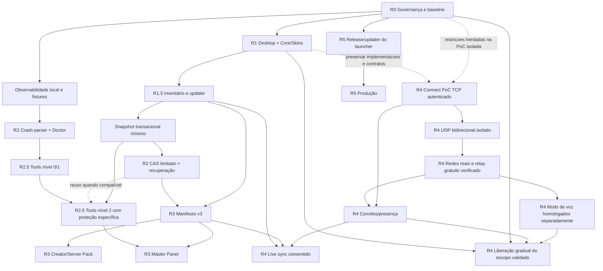

# Dependency Graph

Revisão documental: 29/09/2026, base alpha.14 (`6a107b8`). O grafo representa
dependências de evolução e liberação; não declara todos os nós ausentes ou
homologados. Preservam-se fases, gates e ownership exclusivo por wave.

## Trilho crítico

Para sincronização pública: `R0 → R1 → inventário/updater → proteção/restore → manifesto → multiplayer sync consentido`.
Os contratos de Tools continuam exigindo plano, confirmação, auditoria e recuperação
por capacidade. Uma PoC Connect isolada de bytes não depende de refazer manifesto,
Doctor, Tools ou CAS; sua aprovação não encerra os gates anteriores nem libera R4.

## Estado cumulativo a preservar

- **IMPLEMENTADO MAS NÃO HOMOLOGADO:** Doctor local somente leitura, orientação
  Gemini opcional e Tools estreitas `remove_mod`/`set_setting` com prévia,
  confirmação, histórico e restauração; [contrato](../aurora-ai-tools.md).
- **IMPLEMENTADO MAS NÃO HOMOLOGADO:** pontos manuais, CAS SHA-256/SQLite limitado,
  restore/desfazer e cópias de diagnóstico com aplicação seletiva; [recuperação](../instance-recovery.md),
  [cópias](../diagnostic-lab.md), [evidências alpha.14](../task-aur-1167-doctor-lab.md).
- **NÃO IMPLEMENTADO:** pontos automáticos gerais antes de updates, GC seguro do
  CAS e sua adoção geral pelo downloader; não confundir com o CAS já entregue.
- **NÃO IMPLEMENTADO** na inspeção limitada: Aurora Connect; contratos TCP/UDP,
  NAT, mods e evidências definidos na [especificação V2](AURORA_CONNECT_SPEC.md).

## Wave 0 — gates e paralelismo preservados

- regras/testes Firestore em `firebase/**`;
- licença/avisos em arquivos jurídicos dedicados;
- CI em `.github/workflows/**`;
- proveniência, versionamento e documentação pública, sem substituir binários históricos.

## Wave 1 — continuar a partir da implementação existente

- timeout HTTP/IPC sem tocar no frontend;
- harness runtime sem reescrever adaptadores;
- decomposição do `App.tsx` com ownership exclusivo;
- verificar as lacunas restantes de substituição transacional, preservando os
  executores de updater, Tools e recuperação; não refazer os já entregues.

## Bloqueado

- ampliação de Tools nível 2 sem proteção específica comprovada; as duas ações
  atuais já possuem backup/rollback e continuam aguardando homologação nativa;
- live mod sync até manifesto/autorização, integridade e integração segura com o
  updater existente serem comprovados; existência de updater não homologa sync;
- Master por falta de APIs/roles/manifests estáveis;
- auto-updater por falta de chave de assinatura e política de canal.
- lançamento público por falta de prova Microsoft/Xbox/Minecraft de entitlement; Firebase identifica a conta Aurora, não a posse do jogo.

## Deve esperar

- infraestrutura relay Aurora própria obrigatória, social completo, analytics
  remoto, cosméticos pagos, nível 3 de IA e suporte NeoForge.
- Relay gratuito externo pode ser avaliado sob a política V2: verificação de
  operador, termos, quotas, regiões, autenticação, E2E e ausência efetiva de
  cobrança para o uso pretendido. Aprovação de laboratório não autoriza produção;
  sem opção permitida, o modo direto mantém seus limites explícitos.
