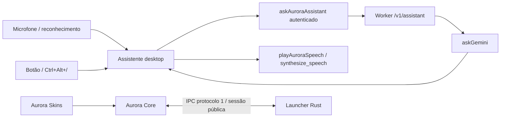

# Retirada do mod Companion; Assistente desktop preservado

**O Assistente permanece no Aurora Launcher; o mod Companion e sua integração in-game foram retirados.** Esta tarefa prepara fontes e candidatos de build. Não publica Worker, não revoga secrets, não gera instalador e não homologa automaticamente gameplay.

## Base e responsabilidade

Base confirmada: repositório principal `C:\Users\usuario\Desktop\AuroraLauncher`, HEAD `84ef55a96c2444b40db227f4c17c5e267e597785`, launcher `0.1.1-alpha.8`. Trabalho isolado em `C:\Users\usuario\Desktop\AuroraLauncher-worktrees\codex-aur-remove-companion`, branch `codex/aur-remove-companion`. `TESTE-main` é outro projeto; sua worktree `aurora-skins-runtime` não é destino desta mudança. A base foi verificada antes das edições; versões históricas não são restauradas automaticamente.

Ownership: integração/Rust/Worker e migração; desktop/smokes; Java/build/matriz; documentação e revisão independente. `AGENTS.md` mantém regras de colaboração, segurança e qualidade; somente a obrigação antiga de distribuir/expandir Companion foi substituída pela [ADR-018](engineering/ADR/ADR-018-remove-companion-keep-desktop-assistant.md).

## Mapa de consumidores

| Arquivo/sistema | Função | Exclusivo do mod / desktop / compartilhado | Consumidores | Remover/manter/adaptar | Teste |
| --- | --- | --- | --- | --- | --- |
| `apps/desktop/src/App.tsx`: `AssistantPanel`, estados e botão | chat, histórico/estado, microfone, áudio, mute | desktop | jogador no launcher | manter | smoke desktop com jogo fechado, build React |
| `App.tsx`: registro `Ctrl+Alt+/` | acesso rápido ao Assistente | desktop; antes encaminhava ao mod | painel | adaptar para alternar painel diretamente | smoke do atalho desktop |
| `App.tsx`: `answerInGame`, `listenInGame`, filas/listeners/timers de retorno | Gemini/voz para o jogo | exclusivo do mod | Companion via IPC | remover; preservar polling de processos/instâncias | rejeição de mensagens antigas, smokes |
| `apps/desktop/src/lib/edge.ts`: `askAuroraAssistant` | transporte autenticado do chat | desktop | painel e smokes de aparência | manter; retirar opção `inGame` exclusiva | testes desktop de rede/timeout e assistant smoke |
| `apps/edge-proxy/src/index.ts`: `/v1/assistant`, `askGemini` | autorização, quotas, Gemini/modelos/fallback | desktop/serviço compartilhado | painel autenticado | manter; adaptar contexto para Aurora Launcher | check e testes Worker; online separado |
| `engine/tts.rs`, `synthesize_speech`, `playAuroraSpeech`, `edge-tts-rust` | síntese/reprodução de voz | desktop | painel | manter | testes Rust, smoke desktop; TTS online separado |
| manifestos/capabilities e plugin global shortcut | permissão/registro de atalho | desktop | `Ctrl+Alt+/` | manter | build, registros e smoke |
| `apps/companion-mod/**` | Java Fabric/Forge/legado, Swing, Mixins, services, bootstrap e recursos | exclusivo do mod | Companion | remover após desacoplar wrapper | busca final, ausência em matriz e bundle |
| `tools/gradle/8.4/**` (antes em Companion) | Gradle 8.4, wrapper JAR/properties/scripts | compartilhado | builds Core/Skins até 1.20.1 e legado | transferir sem upgrade | comparação do wrapper e rebuild serial |
| wrapper de `apps/aurora-core/minecraft/1.21.1` | Gradle 9.7.1/JDK21 | compartilhado | Core/Skins 1.21.1 | manter | builds dos dois alvos 1.21.1 |
| Core API/runtime/adaptadores | módulos, sessão, configuração, menu/preview e IPC | compartilhado | Skins e módulos genéricos | manter; retirar ícone/página Companion | testes Java e contratos Core |
| `apps/aurora-skins/**` | catálogo, textura, preview, aplicação | compartilhado | Core e jogador | manter; confirmar nenhum source set importa Companion | nove builds/contratos, comparação estrita |
| `engine/companion.rs` e exports | seleção/instalação automática do JAR | exclusivo do mod | prepare/launch | remover; adaptar contratos frontend/Rust | launch/instância e busca de registros |
| `commands.rs`, `main.rs`, tipos frontend | retorno de voz/legenda/resposta ao mod | exclusivo do mod | callbacks in-game | remover comandos exclusivos; manter TTS e processos | build/Rust, API de comandos |
| `engine/ipc.rs` e API IPC Java Core | transporte loopback autenticado, sessão, eventos | compartilhado | Core/Skins e processo | manter protocolo 1; remover envelopes Companion | handshake, nonce inválido, sessão, eventos e desconexão |
| telemetria FPS/MSPT/memória/dimensão | dados produzidos pelo Companion | exclusivo do mod | indicador do launcher | remover produtor/indicador morto; preservar diagnósticos reais | tipos e UI sem dados fictícios |
| `engine/companion_migration.rs`, `known-companion-artifacts.json` | identificação e retirada recuperável do JAR antigo | migração/histórico | instâncias Aurora antes do launch | adicionar com hash + metadata, lock, backup/journal | fixtures repetição, terceiro, incerto, link, jogo ativo, falha |
| `scripts/build-aurora-*.ps1`, verifier, package/CI | builds e gates | compartilhado | release e desenvolvimento | remover Companion; derivar 18 JARs de 2 módulos × 9 alvos | rebuild serial, metadata/bytecode/recursos/assinatura e comparador |
| `assistant-smoke.mjs`, `supabase-appearance-smoke.mjs` | chat desktop e preparação de aparência | desktop/compartilhado | QA | manter; retirar só chamada `inGame` | smokes; mocks não comprovam serviço online |
| `toggle-assistant-smoke.mjs` (antes `toggle-ingame-smoke.mjs`) | toggle do mod | mod com atalho desktop compartilhado | QA | adaptar cobertura para painel desktop | botão/atalho sem jogo |
| `core-skins-matrix-smoke.mjs` (antes `companion-matrix-smoke.mjs`) | checks de Core, Skins e antiga ponte | compartilhado | QA | preservar contratos Core/Skins e remover bridge | nove pares; sem reativar mod |
| `functions/`, Firebase, CurseForge, Supabase, catálogo | backend legado e serviços independentes | compartilhado/fora do escopo | launcher e aparência | manter | checks pertinentes; sem deploy |
| `releases/companion/**`, manifestos/checksums passados, auditorias datadas | prova de versões antigas | migração/histórico | catálogo de hashes e histórico Git | preservar bytes; excluir de seleção ativa | inventário/hashes; referências classificadas |

## Dois fluxos distintos

O antigo fluxo `Companion → IPC → launcher → Gemini/voz → resposta ao jogo` foi retirado junto com seus comandos e callbacks. Capturas e legendas exclusivas dele não são substituídas por nova feature desktop. Consultas normais do painel continuam autorizadas e independentes de Minecraft.

## Migração e preservação

A migração ocorre em instâncias gerenciadas antes do launch e sob a exclusão mútua de mutações, mantida pelo processo em execução. JARs de nome estável, versionado ou desativado são examinados por identidade exata e hashes conhecidos; nomes por substring não autorizam remoção. Companion de procedência incerta fica no lugar e o launch informa o bloqueio. Mods de terceiros semelhantes são preservados.

Backup identificado e journal ficam em `.aurora/removed-companion/<transação>/`, fora de `mods`. O journal permite completar uma operação interrompida sem apagar a cópia original/backup; repetição não acumula remoções. Links/reparse points e traversal são recusados. No Windows, a verificação adicional identifica JVM que sobreviveu ao launcher comparando exatamente `--gameDir`. O probe só roda quando há candidato/journal pendente; instâncias comuns não dependem dele. Em outros sistemas, essa migração automática falha de forma segura e preserva os arquivos até existir verificação de processos equivalente; o launch sem candidato permanece disponível. A tarefa usa apenas fixtures/QA e não limpa instâncias reais para demonstrar resultado.

Core, Skins, terceiros, mundos, contas, bibliotecas, aparência e configurações permanecem. Conversa/estado e preferências de voz do Assistente desktop não são alvos da migração. Configurações antigas exclusivas do mod podem ficar inertes; instalações/reparos/atualizações não selecionam Companion novamente.

## Matriz, testes e pendências

Matriz ativa: Forge 1.12.2 e Fabric/Forge 1.16.5, 1.19.2, 1.20.1 e 1.21.1: nove Core + nove Skins = 18 JARs. Core 1.1.5 é candidato versionado assinado; Skins 0.2.4 foi recompilado e passou na comparação estrita com os artefatos existentes. Os wrappers Gradle/JDK preservam as gerações existentes; Loom roda sequencialmente. Não se enfraquece o comparador para aceitar divergências.

Resultados executados em 21/09/2026, na worktree desta tarefa:

| Comando/verificação | Resultado real | Alcance e limite |
| --- | --- | --- |
| `npm --prefix apps/desktop run build` | PASS | TypeScript/Vite; aviso de chunk grande existente; não executa WebView |
| `node --test apps/desktop/tests/*.test.mjs apps/desktop/src/lib/*.test.mjs` | 66/66 PASS | painel/fala/atalho/transportes com adaptadores simulados, polling Core, wardrobe/skins, sessão, startup e downloads; não comprova hardware ou API online |
| `npm --prefix apps/edge-proxy test` | 63/63 PASS | sete novos testes da rota Assistente, autenticação JWT de fixture, launcher, fallback/timeout/quota e recusa de `inGame`/captura sem consultar Gemini |
| `npm --prefix apps/edge-proxy run check` | PASS | Wrangler dry-run; nenhum deploy |
| `cargo fmt --manifest-path apps/desktop/src-tauri/Cargo.toml --all -- --check` | PASS | formato Rust |
| `cargo clippy --manifest-path apps/desktop/src-tauri/Cargo.toml --all-targets -- -D warnings` | PASS | checks Rust, incluindo registros Tauri/tts |
| `cargo test --manifest-path apps/desktop/src-tauri/Cargo.toml` | 85 testes lib + 15 binário PASS; 3 online ignorados na execução padrão | migração, processo, IPC/sessão/eventos, artefatos e engine; doc tests 0 |
| `cargo test --manifest-path apps/desktop/src-tauri/Cargo.toml --lib engine::tts::tests::synthesizes_portuguese_audio_with_sentence_boundaries -- --ignored` | 1/1 PASS, serviço online real | Edge TTS gerou áudio e limites de sentença; não comprova reprodução audível ou microfone |
| Wrapper neutro: Core `clean check` e Skins `clean build`, antes de excluir a pasta Companion | PASS | desacoplamento comprovado; Gradle 8.4 e wrapper 9.7.1 preservados |
| `npm run core:build` + `npm run skins:build`, sequenciais | 9/9 Core + 9/9 Skins PASS | builds fora de Companion; 9 testes Java Core e 16 Skins PASS; não é gameplay |
| `powershell -NoProfile -ExecutionPolicy Bypass -File scripts/verify-mod-release-matrix.ps1 -SkipBuild`, após os dois rebuilds | 18/18 PASS | comparador estrito de todas as entradas; 9 hashes/tamanhos/assinaturas Ed25519 Core PASS; Skins histórico intacto |
| `powershell -NoProfile -ExecutionPolicy Bypass -File scripts/verify-mod-release-matrix.test.ps1` | 4/4 PASS | rejeita classe Companion, conteúdo divergente, alvo faltante e JAR extra sem tocar em releases reais |
| `node --check` dos smokes desktop/aparência/Core-Skins | PASS | sintaxe; scripts nativos dependem de WebView QA e não foram executados |
| Links Markdown relativos + `git diff --check` | PASS | 84 documentos verificados, zero links quebrados; Companion IPC renomeado e índices atualizados |

Os nove testes focados da migração passaram, incluindo todos os **47 JARs históricos** do catálogo com hash/metadata reais, nomes estáveis/versionados/desativados, repetição, identidade incerta, terceiros, trava de processo/guard incorreto, journal antes/depois da movimentação, traversal e junction Windows. Fixtures separadas validam comparação exata de `--gameDir` (aspas, barras/case, prefixo semelhante e classpath) e o teste de IPC usa o wire serializado real `connected`/`minecraft_version`.

A revisão independente confirmou que `AssistantPanel` permanece idêntico à base (somente normalização de fim de linha), assim como `tts.rs`, dependências Rust, capabilities e `supabase-appearance-smoke.mjs`. Scripts/properties do wrapper preservam o conteúdo e o wrapper JAR preserva bytes. Nenhum binário/manifesto/checksum histórico mudou. A inspeção ZIP dos 18 JARs ativos não encontrou classes `com/aurora/mod/`. Foram corrigidos durante QA o casing do evento Core no frontend e falsos positivos da detecção de processo por prefixo de diretório.

A primeira tentativa Core Forge 1.20.1 encontrou limite de heap em remap paralelo; os scripts agora passam `--no-parallel --max-workers=1`, e o rebuild completo sequencial passou. Não houve atualização geral Gradle/JDK ou relaxamento do comparador.

Evidências locais ignoradas pelo Git: `.aurora/rust-tests.log`, `.aurora/rust-clippy.log`, `.aurora/migration-tests.log`, `.aurora/tts-online-test.log`, `.aurora/desktop-full-tests.log`, `.aurora/desktop-companion-removal-validation.md` e `.aurora/companion-removal/{matrix-core.log,matrix-skins.log,matrix-verify.log,matrix-negative-tests.log,java-test-results.json}`.

O teste gráfico completo Core/Skins nas nove combinações, o desktop nativo/empacotado, o atalho físico do sistema operacional, Gemini autenticado online, reprodução audível e microfone real permanecem **PRECISA DE TESTE**. A consulta de capacidade encontrou nenhum processo Aurora/endpoint WebView QA ativo; nenhum smoke foi aplicado a uma sessão real de usuário. Evidências antigas estão identificadas como históricas na [matriz](engineering/COMPATIBILITY_MATRIX.md), sem extrapolação para esta alteração.

Mudanças do Worker são somente de fonte: exigem implantação posterior autorizada. Nenhum instalador novo, deploy ou revogação de chave faz parte desta tarefa.

## Referências restantes

- **Desktop preservado:** `AssistantPanel`, `askAuroraAssistant`, Gemini, TTS, microfone, controles/estilos e atalho.
- **Serviço compartilhado:** autenticação/transporte, Core/Skins, IPC/sessão/eventos e infraestrutura Gradle.
- **Migração/histórico:** identidade `aurora_companion`, hashes de releases antigas, backups/journal, testes negativos e documentos datados. A proteção antiga no updater impede atualizar/restaurar Companion por provedores; os paths históricos nos gates de worktrees impedem ignorar trabalho alheio pendente, sem selecionar o mod para build/distribuição.
- **Resíduo ativo do mod:** qualquer seleção/instalação de JAR, página `aurora_assistant`, comando/callback de ponte ou dependência de build ainda apontando à pasta removida é falha a corrigir, não exceção documental.

## Commits da entrega

- `0595277`: painel desktop preservado, remoção da ponte in-game e suporte Core/Skins na UI.
- `7a82ea3`: Worker mantém Gemini desktop e rejeita payloads exclusivos do mod.
- `a56a2db`: smokes desktop/atalho adaptados.
- `8f04aae`: mapa/ADR/guias/matriz e classificação histórica.
- `ff94490`: diagnóstico Core consome o contrato IPC existente corretamente.
- `0137590`: mod Java retirado, wrappers desacoplados, matriz/build/gates Core/Skins.
- `786ab46`: candidatos Core 1.1.5 assinados, sem UI de Assistente no jogo.
- `7309a81`: migração recuperável, remoção de comandos/instalação e preservação IPC.
- `1b82f41`: launcher seleciona candidatos Core 1.1.5 e não embarca Companion.
