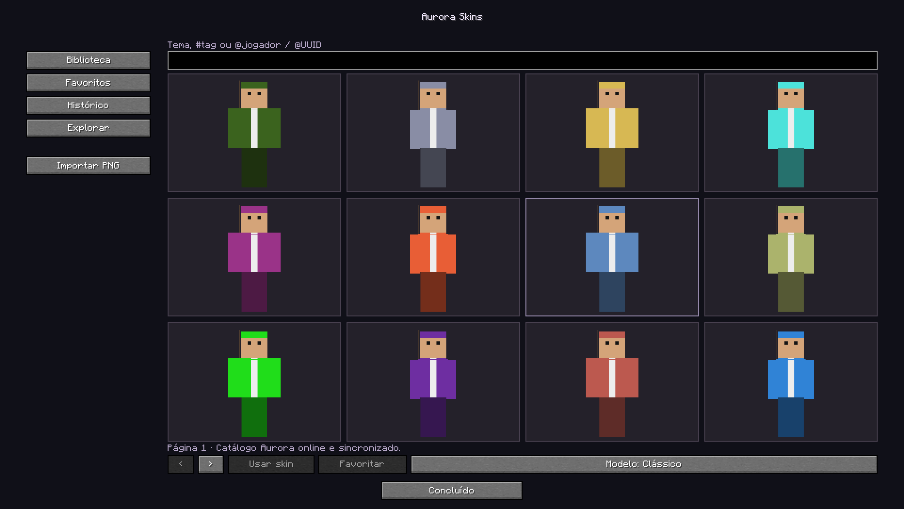
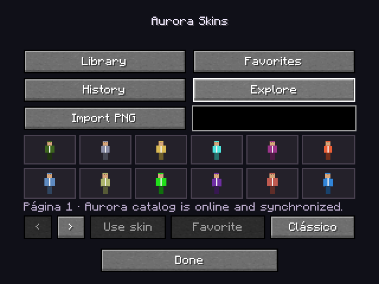

# Catálogo in-game com 12 slots — 21/09/2026

Estado: **PARCIAL**: implementação nos nove alvos, builds e testes aprovados; verificação gráfica focada em três pares. Worktree exclusiva
`codex/aur-skins-grid`, criada a partir de `52ed803` (retirada do Companion),
sucessor de `84ef55a` na base principal. A expansão multiversão ainda era um
prompt/planejamento; foram preservados os nove alvos ativos. Assistente,
Gemini, voz, chat e guarda-roupa desktop estão fora das mudanças desta tarefa.

## Fluxo e implementação

`AuroraSkinsRuntime` fornece o mesmo `AuroraCatalogProvider` a todas as telas.
Explorar chama `searchDebounced(query, page, CatalogGridState.PAGE_SIZE)`,
recebe `SkinPage` já paginado e usa exclusivamente `preview(entry)` para
preencher os modelos. A API/Worker e o preview global do Core não mudaram.

- Estado Java 8 comum: 12 slots, página confirmada, `hasMore`, identidade da
  seleção, loading/ready/falha/vazio e gerações de consultas/prévias.
- Geometria comum: 4 × 3 ou 6 × 2 em áreas baixas, coordenadas lógicas e
  espaço independente para status e os controles existentes.
- Adaptadores modernos: telas 1.16.5, 1.19.2 e 1.20.1; 1.21.1 continua
  consumindo a tela 1.20.1 com seu renderer próprio.
- Legado 1.12.2: hooks/reflexão MCP/SRG preservados, conversão de mouse
  físico/lógico e consumo dos cliques pertencentes ao Skins.
- Renderers por slot, pose fixa, textura correta antes de habilitar seleção,
  liberação ao mudar de aba/página ou fechar. Resize mantém os recursos.
- Cache: dois workers existentes, coalescência por origem/hash do PNG,
  prévias por identidade/modelo, limite de 96 prévias e 96 operações em
  andamento, disco validado sem escrita de metadados de biblioteca.

Clique só seleciona. Aplicar continua explícito. Favoritar, Modelo e Importar
mantêm seus efeitos existentes; Modelo/Importar podem aplicar pela ação
explícita que já possuíam. Páginas/pesquisas novas começam sem seleção.
Resposta curta ou vazia não determina última página: somente `hasMore`.
Sem nomes, números, badges ou estrelas nos cards; fundos planos e bordas
simples substituem decoração e animações.

## Verificações

| Verificação executada | Resultado |
| --- | --- |
| Core 1.1.5, matriz completa | 9/9 builds; API e fontes Core inalteradas pela grade |
| Skins 0.2.5, matriz completa após congelamento dos adaptadores | 9/9 builds |
| Skins core, Java 17 / bytecode release 8 | 30 testes aprovados, incluindo 13 novos de estado/geometria e um de cache concorrente |
| Legado, compilação contra Forge/Core reais, execução Java 8u504 | 3 suítes aprovadas: OpenGL/reflexão, ownership Core e grade |
| Rust, contratos dos JARs | 9/9 pares aprovados; metadata, mixins, recursos, bytecode, dependências e classes comuns da grade |
| Rust completo | 85 testes lib + 15 binário aprovados; 3 testes online ignorados |
| Clippy all-targets -D warnings / fmt check | aprovados |
| Equivalência de fontes/artefatos e assinaturas | 18/18 JARs; 9 hashes/tamanhos/assinaturas Ed25519 Core aprovados |
| Revisão independente | lógica comum, provider, adaptadores e renderers revisados; correções incorporadas |

Geometria testada: 320×240, 427×240, 560×260, 854×260, 320×480, 854×480,
1920×1080 e 3840×2160 lógicos. Sequências de 0,1,11, 12,13,24,25 resultados,
página curta/vazia com hasMore, identidade/modelo, respostas fora de ordem,
fechamento, normalização 64×32 e ausência de efeitos persistidos do preview.
O fixture legado prova 12 modelos e 12 texturas distintas (144 partes
corpo/segunda camada), cliques físicos/lógicos, resize sem upload novo,
liberação das texturas e ação capturada durante troca de seleção.

A revisão encontrou e corrigiu cache corrompido sem recuperação e futures
concluídas acumuladas durante alterações repetidas de modelo. PNG inválido
agora só é substituído após validar o novo arquivo e publicar atomicamente.

Logs locais ignorados: .aurora/grid-core-build.log,
.aurora/grid-skins-final-build.log, .aurora/grid-equivalence.log,
.aurora/grid-rust-tests.log e .aurora/grid-clippy.log.
A matriz final foi repetida após o último ajuste do diálogo de importação;
a primeira compilação não foi usada para declarar a equivalência final.

Fixture local: `node scripts/skins-grid-fixture.mjs` oferece 25 PNGs sintéticos
distintos em `127.0.0.1:18741`, alternando Classic/Slim e incluindo 64×32.
As buscas `one`/`none` dão um/zero resultado, e `/counts` registra requisições
por rota para verificar cache. Defina `AURORA_QA_CATALOG_URL` com a URL local
ao executar `scripts/launch-skins-qa.mjs`. O launcher de QA mantém identidade
fictícia e pasta nova; `AURORA_QA_RESOLUTION=640x480` cria apenas nessa pasta
GUI scale 2 (320×240 lógicos); `AURORA_QA_MINIMAL=1` mantém apenas Core,
Skins e Fabric API, quando disponível. O script só lê bibliotecas/assets/mods
de uma instalação existente, sem copiar contas ou mundos.

## Entrega

Commit de implementação, testes e nove artefatos:
`1d4f8c83f8b25e8a602e8b258e6763e1e188112e`, na branch `codex/aur-skins-grid`.
O commit seguinte registra essa identificação sem alterar fontes ou JARs.

Skins 0.2.5 e Core 1.1.5. Candidatos primeiro em
`.aurora/build-matrix/skins/0.2.5`; releases anteriores são imutáveis.
Nenhum instalador ou serviço é publicado por esta tarefa.

## Verificação gráfica real

| Sessão isolada | Ambiente | Observado |
| --- | --- | --- |
| grid-1122-a | Forge 14.23.5.2860 / Java 8u504 / 22 mods | 12 corpos/texturas, seleção dourada, páginas 12 + 12 + 1, última seta bloqueada, vazio inativo, Apply explícito, PNG 64×32, busca one retornando 1 slot e página 1, fullscreen 1920×1080, Core→Skins→Core e fechamento |
| grid-1201-a | Fabric 0.14.23 / Java 17.0.20.1 / 151 mods | placeholders, 12 corpos/texturas, clique, aplicação Classic e página 2 sem seleção; janela 960×540 |
| grid-1211-a | Fabric 0.19.3 / Java 21.0.12.1 / 160 mods | 12 corpos/texturas nítidos, clique, aplicação Slim persistida e página 2 sem seleção |
| grid-1211-small | Mesmo Fabric/Java / 160 mods | 427×240 lógicos, 12 corpos dentro dos cards; F11 preserva página e texturas, expandindo para 4×3 em 960×540 lógicos |
| grid-1201-api | Fabric 0.14.23 / Fabric API 0.90.0+1.20.1 / Java 17 | 320×240 lógicos, traduções corretas e 12 modelos dentro dos cards |
| grid-1201-minimal | Fabric 0.14.23 / Java 17 / somente Core + Skins | 320×240 lógicos: 12 corpos dentro dos cards. Sem Fabric API, traduções não são carregadas; limitação de dependência descrita abaixo |

Todos usam Core 1.1.5 e os JARs Skins 0.2.5 finais. Hashes completos dos nove
JARs: [manifesto](../releases/skins/0.2.5/manifest.json). Os hashes dos JARs
carregados nas sessões foram conferidos contra esses candidatos. Core mantém
seu manifesto assinado em releases/core/1.1.5.

Na sessão legada, clicar/paginar não criou active.properties nem library.index.
Aplicar criou somente a seleção explícita QA 25; o menu exibiu essa textura.
Na 1.21, aplicar QA 2 persistiu model=slim. O servidor de fixture contou uma
requisição por PNG visitado em cada sessão isolada; mudar tamanho e permanecer
na tela não aumentou essa contagem. As suítes conferem liberação de recursos;
a observação visual não constitui medição universal de FPS ou memória GPU.

### Limites observados

- A tentativa grid-1201-small com 151 mods terminou com EXCEPTION_ACCESS_VIOLATION
  em glfw.dll enquanto estava no diálogo inicial Controlify, antes de abrir
  Skins. Não foi classificada como aprovação nem atribuída ao catálogo sem
  evidência. O teste mínimo subsequente abriu a grade em 320×240.
- Fabric sem seu módulo de carregamento de recursos não carrega as traduções
  dos mods: o teste bare exibiu chaves em inglês, apesar dos JSONs presentes
  nos JARs. A metadata existente não exige Fabric API. Essa limitação foi
  observada com a metadata herdada sem alteração; não foi classificada como
  homologação dessa configuração. O modo mínimo do script conserva Fabric API
  do cache quando disponível para reproduzir o ambiente de recursos normal.
- Fabric/Forge 1.16.5, Fabric/Forge 1.19.2 e Forge 1.20.1/1.21.1: builds/contratos
  aprovados; nova homologação gráfica desses seis pares **PRECISA DE TESTE**.
- API pública, pesquisa por jogador real, gameplay/multiplayer, autenticação,
  capas e todo o roteiro em cada GUI scale **NÃO VERIFICADO** nesta rodada.
  O teste usa catálogo local real no protocolo TSV com PNG/hash, não a rede
  externa; as regressões existentes do provider permanecem aprovadas.
- Não foram alteradas instâncias pessoais, contas ou mundos. Nenhum mundo foi
  criado nesta rodada. As sessões foram encerradas após o roteiro.
